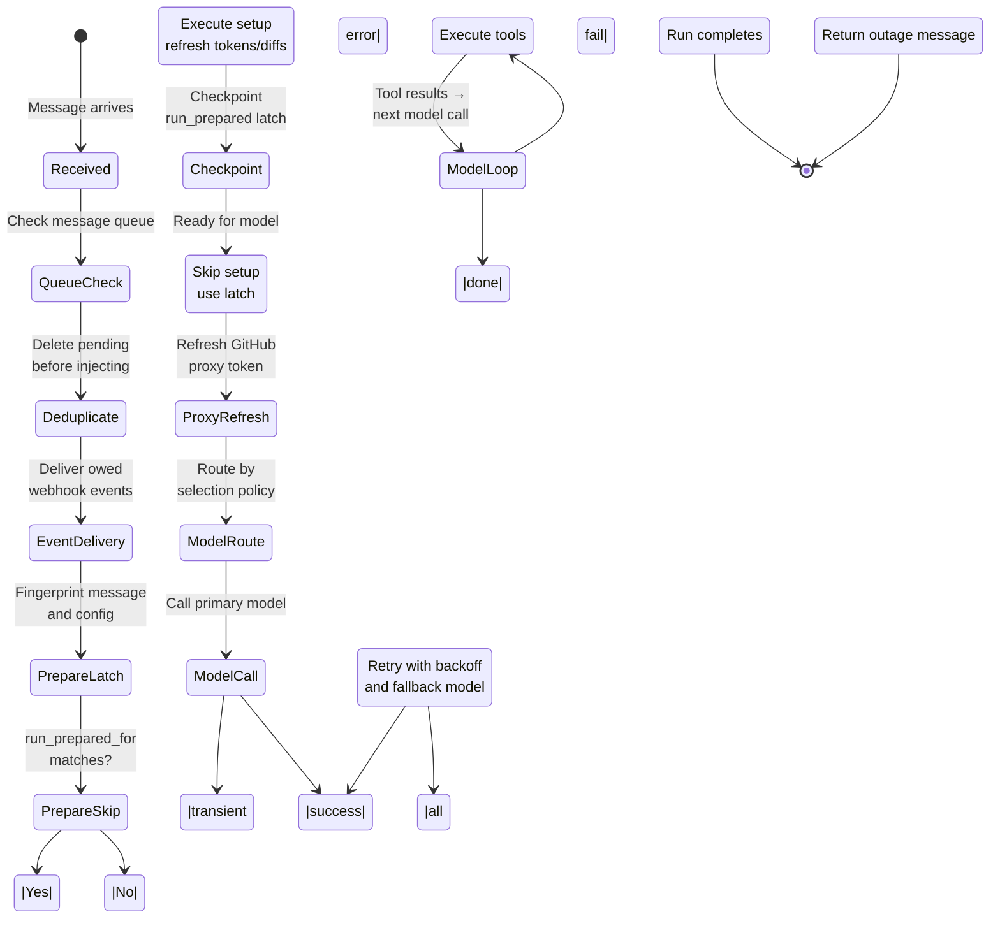

# Middleware Stack and Request Processing

`build_agent(config)` in `openswe/server.py` composes ordered middleware into a graph with `create_deep_agent` from the deepagents library. The middleware list is an onion: earlier entries wrap later entries, so an outer layer can intercept, modify, or handle exceptions from every inner layer. This makes order part of the runtime contract, not an implementation detail. Middleware is categorized by responsibility: model-selection, tool-related, run-setup, flow-control, and integration-specific. Each intercepts at distinct points in the model-tool-state loop and mutates the `PrepareRunState` or global state in a coordinated sequence.

The architecture uses a layered model where:

- **OpenSWE middleware** (openswe/middleware/) shapes agent behavior, manages state, enforces policies, and integrates with external systems.
- **LangChain middleware** (langchain.agents.middleware) handles core model and tool lifecycle: `ModelCallLimitMiddleware`, `ModelRetryMiddleware`, etc.
- **DeepAgents framework** (deepagents) assembles the middleware stack into a runnable graph with filesystem, skills, and core tool execution.

See [Coding Agent Assembly](agent-graph.md), [Sandbox Lifecycle](sandbox-lifecycle.md), and [PR Creation](../workflows/pr-creation.md) for the graph, review, sandbox, and delivery contexts.

## OpenSWE Middleware and Their Responsibilities

### Model-selection middleware

These middleware select, validate, or route model choices:

- **`ModelSelectionMiddleware`** (conditional, enabled if adaptive routing configured)  
  Allows the agent to route requests between a primary and alternate model based on configured routing rules and request characteristics. Only installed when `model_selection` is provided. Permits resuming a routing task if adaptive routing is subsequently disabled. Routes model choices based on configured decision logic and persists the selected route in state.

- **`ModelFallbackMiddleware`** (conditional, installed only when a different fallback model is available)  
  Wraps the model call in a retry loop that alternates between primary and fallback models on transient errors using exponential backoff with jitter. It retries on 5xx/429-class HTTP statuses, connection/timeout errors, and `TimeoutError` from the deadline middleware (when present). An immediate provider model access error (`model_not_available` / `model_not_found`) short-circuits to a user-facing `AIMessage` without retrying. When all attempts fail, it returns a terminal outage message by default; `surface_outage_message=False` re-raises the final error instead. Alternate providers recover faster from transient gateway outages than a single failover would.

### Tool-related middleware

These middleware control, validate, or handle tool execution:

- **`DynamicToolMiddleware`** (conditional, installed if integration groups present)  
  Exposes configured integration groups (MCPs, Notion) lazily: tool names are visible to the model up front, but the actual tools are built only after the model requests them. Positioned after fallback to avoid loading integrations during retries.

- **`ExcludeToolsMiddleware`**  
  Filters disallowed tool names from model requests. Hides tools that the model should never see by implementing `CallShape.hiding()`. Applied after dynamic tools are loaded.

- **`ClientToolsMiddleware`** (conditional, only if client tools configured)  
  Exposes tools that the client frontend provides and controls, allowing client-side tool execution without backend involvement.

- **`TaskCoordinationMiddleware`** (conditional, only if worker mode active)  
  Coordinates task delegation to async worker processes, managing task lifecycle and status tracking for background execution.

- **`IncidentMiddleware`** (conditional, only if incident session active)  
  Adapts run policy (e.g., model call limits) and tools when an incident is being actively tracked, enabling focused incident response workflows.

### Run-setup middleware

These middleware prepare and inject contextual state:

- **`PrepareAgentRunMiddleware` (concrete: `PrepareReviewerRunMiddleware` for reviewer)**  
  Checkpointed per-run setup that fingerprints the latest message, middleware class, and preparation configuration. A matching `run_prepared_for` latch on `PrepareRunState` skips setup when resuming the same invocation; a new invocation on the same thread re-prepares. Preparation is idempotent because failures before the checkpoint can re-run it. Its model wrapper injects the rendered system prompt into every model call. Setup may refresh tokens, fetch new diffs, or resolve review context. The `ashape_model_call` hook adds the system prompt section contributed by preparation.

- **`ConversationOffloadingMiddleware`**  
  Defers conversation context to external storage when configured by the user, permitting long runs without hitting provider context limits. Moves entire conversation branches to persistent storage and reconstructs them on resume, keeping the active message list lean.

- **`TranscriptMiddleware`**  
  Processes conversation state and populates the transcript for debugging and auditing. Positioned immediately after `PrepareAgentRunMiddleware`. Per-run state is managed by a module-level registry keyed by `thread_id:run_id`. Events are queued and written by a background writer per run so the model stream never waits on the database. Observes model calls and tool execution via `awrap_model_call`.

- **`AnthropicPromptCachingMiddleware`** (from langchain_anthropic)  
  Optimizes Anthropic model calls by caching the system prompt and file context to reduce token usage and latency for multi-turn interactions.

### Flow-control and policy middleware

These middleware enforce constraints and drive completion:

- **`ModelCallLimitMiddleware`** (from langchain.agents.middleware)  
  Enforces a per-run limit on model calls. When exhausted, it terminates the agent and injects a marker message. `notify_step_limit_reached` recognizes this marker and posts a Slack notification.

- **`RequireUserReplyMiddleware`**  
  Ensures the user has provided explicit feedback via a configured reply tool before the agent continues, blocking premature self-iteration.

- **`RequireCliResultMiddleware`** (conditional, only if CLI thread)  
  Ensures CLI output is available before continuing, used for bridged CLI invocations.

- **`notify_step_limit_reached`** (after-agent hook)  
  Recognizes the `ModelCallLimitMiddleware` marker and posts an explanatory Slack message when the agent hits its step limit.

- **`record_run_usage`** (after-agent hook)  
  Persists summarized token usage when the run has a preparation-run ID and schedules deferred cost enrichment. Bookkeeping failures are caught and do not alter the agent result.

### Policy guards (shell_guards, not in main middleware list)

These middleware enforce safety constraints at tool-execution time:

- **`PullRequestCreationGuardMiddleware`** (not installed for local runs, in `surface.shell_guards`)  
  Blocks `execute` and `background_execute` command forms that create pull requests outside `open_pull_request`, including GitHub CLI, API, curl, and nested bash constructs. Returns a tool error instead of executing.

- **`WorkflowPushGuardMiddleware`** (in `surface.shell_guards`)  
  Blocks push changes to `.github/workflows` files without recorded human approval. Returns a blocked result with an approval URL instead of allowing the push. Prompts for approval only once per push path and accepts user consent via dashboard link.

### Model-call boundary and error handling

- **`ModelErrorMiddleware`**  
  Logs and classifies model-call exceptions, recording the error type and classification code in thread metadata when context is available. Re-raises the original exception unchanged, preserving the error category for completion handling even where platform messages are scrubbed.

### Message preparation

- Message sanitizers (from langchain and openswe)  
  Prepare provider-specific message formats and clean unsupported content blocks before the provider call.

- **`StableToolResultOrderMiddleware`** (built into deepagents)  
  Ensures tool results are ordered stably and deterministically across message lists, allowing the model to rely on consistent result positions.

### Before-model hooks

These hooks run before each model call:

- **`refresh_github_proxy_before_model`** (unless worker mode)  
  Refreshes a near-expiry sandbox GitHub-proxy installation token that expires after one hour, preventing 401s on git/gh commands in long-running agents.

- **`check_message_queue_before_model`** (not stop-summary mode)  
  Reads `("queue", thread_id)` from the LangGraph store, deletes `pending_messages` before constructing the message list to avoid duplicate delivery, and injects queued human input in FIFO order. Also consumes a pending autofix event.

- **`deliver_event_matches_before_model`** (except in stop-summary mode)  
  Appends webhook-driven events owed by the thread from the database in oldest-first order, preventing event delivery delays until run completion.

### Reviewer-specific middleware

- **`RepairOrphanedToolCallsMiddleware`**  
  Inserts synthetic error `ToolMessage` results for tool-call IDs that have no corresponding result before model calls. Prevents permanently wedged reviewer threads when runs are interrupted mid-tool-call.

- **`settle_review_check_on_exit`** (after-agent hook)  
  Closes an unpublished tracked reviewer check as **neutral** so an incomplete review is not presented as a PR code failure. If `publish_review` completed but its conclusion PATCH failed transiently, the hook retries the stored pending real conclusion.

## Coding-agent middleware stack

The coding-agent middleware chain is outer to inner (assembled by `build_agent()` in `/openswe/server.py#L1891-L1943`). Each wraps the next, forming a defense-in-depth model for failure handling and request shaping. This list shows only the openswe-specific middleware; deepagents also installs its own middleware for filesystem tools, skill management, and core tool execution:

| # | Middleware | Type | Condition |
|---|---|---|---|
| 1 | AnthropicPromptCachingMiddleware | optimization | always |
| 2 | ConversationOffloadingMiddleware | run-setup | always |
| 3 | PrepareAgentRunMiddleware | run-setup | always |
| 4 | ReviewGuideMiddleware | integration-specific | guide present |
| 5 | TranscriptMiddleware | run-setup | always |
| 6 | ClientToolsMiddleware | tool-related | client tools present |
| 7 | IncidentMiddleware | integration-specific | incident session present |
| 8 | ModelCallLimitMiddleware | flow-control | always |
| 9 | ExcludeToolsMiddleware | tool-related | always |
| 10 | TaskCoordinationMiddleware | integration-specific | worker mode active |
| 11 | refresh_github_proxy_before_model | model-call | unless worker mode |
| 12 | check_message_queue_before_model | model-call | not stop-summary mode |
| 13 | deliver_event_matches_before_model | model-call | not stop-summary mode |
| 14 | RequireUserReplyMiddleware | flow-control | always |
| 15 | RequireCliResultMiddleware | flow-control | CLI thread |
| 16 | notify_step_limit_reached | flow-control | always (after-agent hook) |
| 17 | record_run_usage | flow-control | always (after-agent hook) |
| 18 | ModelSelectionMiddleware | model-selection | adaptive routing enabled |
| 19 | ModelFallbackMiddleware | model-selection | fallback model differs |
| 20 | DynamicToolMiddleware | tool-related | integration groups present |
| 21 | ModelErrorMiddleware | error-handling | always |

**Shell guards** (applied at tool execution time, not in middleware list):
- PullRequestCreationGuardMiddleware
- WorkflowPushGuardMiddleware

## PrepareRunState and mutation flow

`BasePrepareRunMiddleware` defines `PrepareRunState`, which extends the agent's `AgentState` with checkpoint fields:

- **`run_prepared`**: Boolean latch set to `True` after successful preparation.
- **`run_prepared_for`**: SHA256 fingerprint of `{"middleware": class name, "message": latest message fingerprint, "config": subclass-provided config}`. When resuming the same invocation, a matching fingerprint skips preparation.

The preparation flow is:

1. Agent factory calls `_prepare(state, runtime)` in the before-agent hook.
2. `_prepare` fingerprints the latest message, class name, and configuration details.
3. If `run_prepared_for` matches the computed fingerprint, skip setup (resumed invocation).
4. Otherwise, execute setup, collect updates dict, and return `{"run_prepared": True, "run_prepared_for": fingerprint, **updates}`.
5. LangGraph checkpoints this state after the before-agent node.
6. `ashape_model_call` merges `rendered_system_prompt` into the system message before each model call.

Preparation must be idempotent: a failure before the checkpoint can cause re-execution. Setup typically refreshes authorization tokens, loads diffs for reviewers, or resolves model-specific parameters. After an in-checkpoint failure and resume, the latch prevents preparation from running again as long as the fingerprint matches.

## Message processing pipeline

Per-run pipeline from message arrival through model and tool loops to completion.

## Model call shaping (ashape_model_call)

Middleware that implements the `ShapesModelCalls` protocol can contribute to the system prompt and hide tools from model calls. The `ashape_model_call` hook is called on each model invocation with the current `CallShape` (system prompt sections and hidden tools), the state, and the runtime. Middleware can:

- **Prepend or append** system prompt sections with `call.prepending(section)` or `call.appending(section)`
- **Hide tools** with `call.hiding(tool_names)`

The final system prompt is the result of all middleware contributions in order, and hidden tools are removed from the model's tool list. This is distinct from `awrap_model_call`, which wraps the actual model invocation and observes transcripts/usage.

Key middleware using `ashape_model_call`:
- `PrepareAgentRunMiddleware`: Injects the rendered system prompt from run preparation
- `ExcludeToolsMiddleware`: Hides disallowed tools
- `DynamicToolMiddleware`: Hides tools not yet loaded from the model's view

## Model-call retry flow

`ModelFallbackMiddleware` is installed only when `LLM_FALLBACK_MODEL_ID` or the primary model's default fallback differs from the primary. By default, it makes six attempts (schedule: `0, 5, 15, 30, 45` seconds backoff plus ±25% jitter), alternating primary and fallback models. Each attempt applies the backoff delay, then calls the handler with the active model.

It retries on:
- 5xx HTTP status codes
- 429 (rate limit) status codes
- Connection errors and socket timeouts
- `TimeoutError` from deadline middleware (when present)

An immediate `model_not_available` or `model_not_found` error short-circuits to a user-facing message without consuming retry attempts. Exhausted retries trigger the terminal-outage behavior: by default an `AIMessage` describing the service outage; with `surface_outage_message=False` the final exception is re-raised.

## Transcript offloading and background writing

`TranscriptMiddleware` manages per-run transcript event collection and persistence without blocking the model stream:

- One middleware instance serves all runs; per-run state lives in a module-level registry keyed by `thread_id:run_id`.
- Events are queued (enqueue) and processed by a background writer asyncio task per run, so `append` calls never wait on database I/O.
- A `ContextVar` holds the subagent namespace, which travels downward into nested graph invocations from within tool coroutines.
- Transcript writes are observability: every failure is logged and swallowed so a transcript problem can never fail a run.
- Events include model messages, tool calls/results, reasoning blocks, usage metrics, errors, and turn state.

## WorkflowPushGuardMiddleware approval flow

When `execute` or `background_execute` tool calls contain a `git push` command targeting `.github/workflows` files:

1. **Detection**: Middleware parses shell commands and detects `git push` operations using regex and shell tokenization.
2. **Diff inspection**: If the push is found, the middleware queries the sandbox for the diff between base and head commits to extract affected workflow files and a statistical summary (additions/deletions).
3. **Fingerprinting**: A SHA256 fingerprint is computed from the diff content, ensuring only exact push changes are approved. Inherited workflow changes (from merging a base branch) are noted separately.
4. **Approval check**: The middleware checks the database for a prior approval record matching the fingerprint.
   - If approved, the original `git push` command is executed.
   - If pending or never seen, a Slack approval request is posted **once per unique fingerprint** (marked `notified` after posting).
   - If rejected, a user-facing error message is returned.
5. **User approval**: The approval URL directs the user to a dashboard link that records consent, tied to the fingerprint and thread.
6. **Resume behavior**: On the next model call, the approval check re-runs and sees the stored approval, then executes the push.

The blocking result includes a diff preview (truncated to 400 lines, 20,000 chars) and the approval fingerprint.

## Reviewer middleware chain

The reviewer graph installs a markedly leaner middleware stack than the coding agent because reviewers are read-only and deterministic (assembled in `/openswe/reviewer.py#L1110-L1150`):

| # | Middleware | 
|---|---|
| 1 | PrepareReviewerRunMiddleware |
| 2 | AnthropicPromptCachingMiddleware |
| 3 | ModelCallLimitMiddleware |
| 4 | ExcludeToolsMiddleware |
| 5 | refresh_github_proxy_before_model |
| 6 | check_message_queue_before_model |
| 7 | RepairOrphanedToolCallsMiddleware |
| 8 | ModelRetryMiddleware (TimeoutError only) |
| 9 | ModelErrorMiddleware |
| 10 | settle_review_check_on_exit (after-agent hook) |

**Key differences from coding agent:**

- No conversation offloading, transcript, incident, client tools, task coordination, model selection, model fallback, dynamic tools, or shell guards.
- Uses langchain's `ModelRetryMiddleware` for `TimeoutError` only (not cross-provider fallback).
- Adds `RepairOrphanedToolCallsMiddleware` to fix interrupted review threads.
- Adds `settle_review_check_on_exit` to mark incomplete reviews as neutral.
- Deterministic repo prep (single clone-or-fetch + checkout) before the first model call, avoiding token burn on git commands.
- No push, commit, or PR-opening tools; review is read-only and deterministic.

## Tool and message safety invariants

**Sandbox resilience:**  
Reviewer sandbox setup opts into replacement because its checkout is re-derived for each run and a persistent PR thread should not be bricked by a dead sandbox. The coding agent's sandbox setup deliberately does not auto-replace to avoid concealing loss of uncommitted work.

**Workflow push approval:**  
`WorkflowPushGuardMiddleware` intercepts `execute` and `background_execute` tool calls and parses for `git push` commands targeting `.github/workflows`. When detected, it blocks the push and posts a Slack approval request with a diff preview, approval URL, and unique fingerprint. Only exact matching of the fingerprinted diff allows the push to proceed; any workflow change causes a new approval prompt. Changes inherited from a merged base branch are noted separately.

**Message deduplication:**  
`check_message_queue_before_model` deletes `pending_messages` from the queue before injecting deferred human input, ensuring Slack replies and web messages are not double-delivered if the agent resumes.

## Integration with DeepAgents

The middleware list passed to `create_deep_agent` is merged with deepagents' own middleware, which provides:

- **FilesystemMiddleware**: Exposes file read/write/delete and directory navigation tools, backend-specific for local vs. sandboxed runs.
- **SkillsMiddleware**: Loads and exposes skills from configured sources.
- **Core tool execution**: Handles tool call dispatch, error handling, and result collection.
- **Message ordering**: Ensures stable, deterministic tool result ordering.

The openswe middleware wraps around these layers, allowing openswe to observe and shape model calls, manage state, enforce policies, and integrate external systems without modifying deepagents internals.
