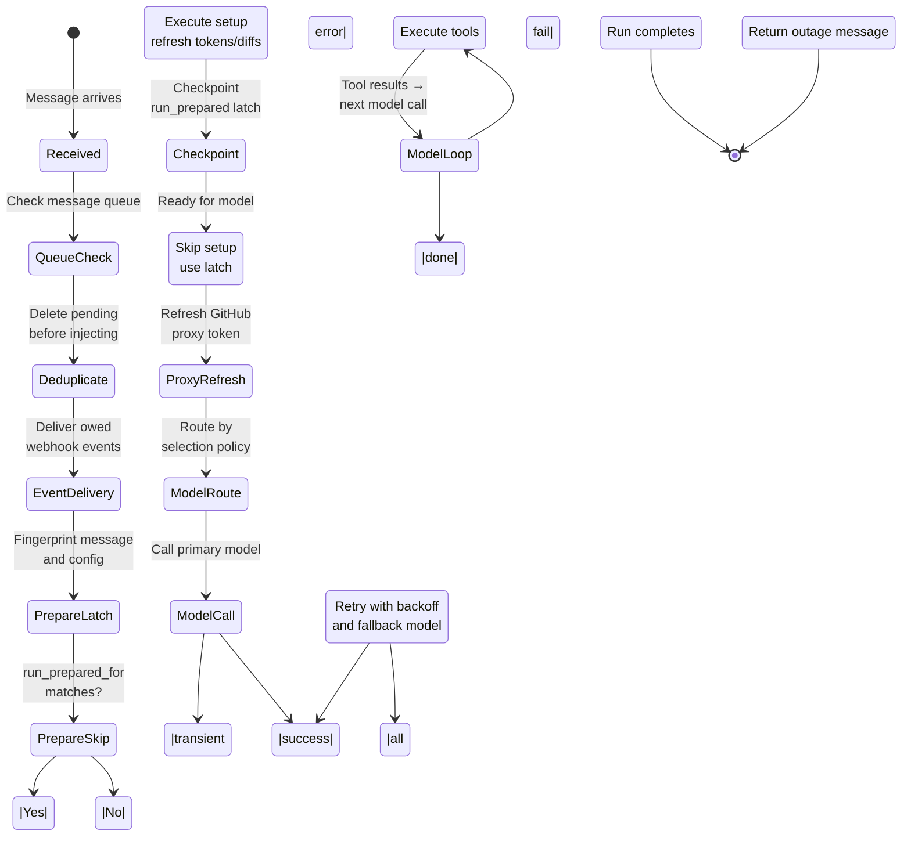

# Middleware Stack and Request Processing

In `/openswe/server.py` the agent middleware stack is assembled as an ordered list around the LangChain agent graph, with earlier entries wrapping later entries to form the onion. This makes order a critical part of the runtime contract: each layer can intercept, modify, log, or handle exceptions from every inner layer. The middleware categories span model routing and fallback, tool lifecycle, run preparation, flow control, and integration-specific concerns. Each intercepts at distinct points in the request loop and may mutate the `PrepareRunState` or global state in a coordinated sequence.

See [Coding Agent Assembly](agent-graph.md), [Sandbox Lifecycle](sandbox-lifecycle.md), and [PR Creation](../workflows/pr-creation.md) for the graph, review, sandbox, and delivery contexts.

## Middleware categories and responsibilities

### Model-selection and fallback middleware

These middleware select, validate, route, or retry model calls:

- **`ModelSelectionMiddleware`** (conditional, enabled if adaptive routing configured)  
  Allows the agent to route requests between a primary and alternate model based on configured routing rules and request characteristics. Only installed when `model_selection` is provided. Permits resuming a routing task if adaptive routing is subsequently disabled.

- **`ModelFallbackMiddleware`** (conditional, installed only when a different fallback model is available)  
  Wraps the model call in a retry loop that alternates between primary and fallback models on transient errors using exponential backoff with jitter. It retries on 5xx/429-class HTTP statuses, connection/timeout errors, and the `TimeoutError` from underlying deadline middleware. An immediate provider model access error (`model_not_available` / `model_not_found`) short-circuits to a user-facing `AIMessage` without retrying. When all attempts fail, it returns a terminal outage message by default; `surface_outage_message=False` re-raises the final error instead.

### Tool-related middleware

These middleware control, validate, or handle tool execution:

- **`DynamicToolMiddleware`** (conditional, installed if integration groups present)  
  Exposes configured integration groups (MCPs, Notion) lazily: tool names are visible to the model up front, but the actual tools are built only after the model requests them. Positioned after fallback to avoid loading integrations during retries.

- **`ExcludeToolsMiddleware`**  
  Filters disallowed tool names from model requests. Applied context-specifically (e.g., PR chat read-only mode, reviewer tool set).

### Run-setup and state preparation middleware

These middleware prepare and inject contextual state:

- **`PrepareAgentRunMiddleware` (concrete: `PrepareReviewerRunMiddleware` for reviewer)**  
  Checkpointed per-run setup that fingerprints the latest message, middleware class, and preparation configuration. A matching `run_prepared_for` latch on `PrepareRunState` skips setup when resuming the same invocation; a new invocation on the same thread re-prepares. Preparation is idempotent because failures before the checkpoint can re-run it. Its model wrapper injects the rendered system prompt into every model call. Setup may refresh tokens, fetch new diffs, or resolve review context.

- **`ConversationOffloadingMiddleware`**  
  Outermost agent middleware after `AnthropicPromptCachingMiddleware`. Defers conversation context to external storage when configured by the user, permitting long runs without hitting provider context limits.

- **`TranscriptMiddleware`**  
  Processes conversation state and populates the transcript for debugging and auditing. Positioned immediately after `PrepareAgentRunMiddleware`. Per-run state is managed by a module-level registry keyed by `thread_id:run_id`. Events are queued and written by a background writer per run so the model stream never waits on the database.

### Flow-control and policy middleware

These middleware enforce constraints and drive completion:

- **`ModelCallLimitMiddleware`**  
  Enforces a per-run limit on model calls. When exhausted, it terminates the agent and injects a marker message. `notify_step_limit_reached` recognizes this marker and posts a Slack notification.

- **`PullRequestCreationGuardMiddleware`** (not installed for local runs)  
  Blocks `execute` and `background_execute` command forms that create pull requests outside `open_pull_request`, including GitHub CLI, API, curl, and nested bash constructs. Returns a tool error instead of executing.

- **`WorkflowPushGuardMiddleware`**  
  Blocks push changes to `.github/workflows` files without recorded human approval. Returns a blocked result with an approval URL instead of allowing the push. Prompts for approval only once per push path and accepts user consent via dashboard link.

- **`notify_step_limit_reached`** (after-agent hook)  
  Recognizes the `ModelCallLimitMiddleware` marker and posts an explanatory Slack message when the agent hits its step limit.

- **`record_run_usage`** (after-agent hook)  
  Persists summarized token usage when the run has a preparation-run ID and schedules deferred cost enrichment. Bookkeeping failures are caught and do not alter the agent result.

### Integration-specific middleware

- **`RequireUserReplyMiddleware`**  
  Ensures the user has provided explicit feedback via a configured reply tool before the agent continues, blocking premature self-iteration.

- **`RequireCliResultMiddleware`** (conditional, only if CLI thread)  
  Ensures CLI output is available before continuing, used for bridged CLI invocations.

- **`IncidentMiddleware`** (conditional, only if incident session active)  
  Adapts run policy (e.g., model call limits) when an incident is being actively tracked.

- **`ClientToolsMiddleware`** (conditional, if client tools present)  
  Exposes client-owned tools to the agent.

- **`ReviewGuideMiddleware`** (conditional, if review guide present)  
  Shapes the agent's behavior according to a review guide session.

- **`TaskCoordinationMiddleware`** (conditional, if task worker active)  
  Coordinates task delegation and worker routing.

### Model-call boundary and error handling

- **`ModelErrorMiddleware`**  
  Logs and classifies model-call exceptions, recording the error type and classification code in thread metadata when context is available. Re-raises the original exception unchanged, preserving the error category for completion handling even where platform messages are scrubbed.

### Message preparation and stability

- **`SanitizeFireworksMessagesMiddleware`, `SanitizeOpenAIResponsesMiddleware`, `SanitizeThinkingBlocksMiddleware`**  
  Prepare provider-specific message formats and clean unsupported content blocks before the provider call.

- **`StableToolResultOrderMiddleware`**  
  Ensures tool results are ordered stably and deterministically across message lists, allowing the model to rely on consistent result positions.

### Reviewer-specific middleware

- **`RepairOrphanedToolCallsMiddleware`**  
  Inserts synthetic error `ToolMessage` results for tool-call IDs that have no corresponding result before model calls. Prevents permanently wedged reviewer threads when runs are interrupted mid-tool-call.

- **`settle_review_check_on_exit`** (after-agent hook)  
  Closes an unpublished tracked reviewer check as **neutral** so an incomplete review is not presented as a PR code failure. If `publish_review` completed but its conclusion PATCH failed transiently, the hook retries the stored pending real conclusion.

## Coding-agent middleware stack

The coding-agent middleware chain is outer to inner (assembled in `/openswe/server.py` around lines 1889–1943). Each wraps the next, forming a defense-in-depth model for failure handling and request shaping. Note: not all middleware appear in a single list; some are conditionally inserted based on configuration:

| # | Middleware | Type | Condition |
|---|---|---|---|
| 1 | AnthropicPromptCachingMiddleware | optimization | always |
| 2 | ConversationOffloadingMiddleware | run-setup | always |
| 3 | PrepareAgentRunMiddleware | run-setup | always |
| 4 | ReviewGuideMiddleware | integration-specific | guide present |
| 5 | TranscriptMiddleware | run-setup | always |
| 6 | ClientToolsMiddleware | tool-related | client tools present |
| 7 | IncidentMiddleware | integration-specific | incident session present |
| 8 | ModelCallLimitMiddleware | flow-control | always |
| 9 | ExcludeToolsMiddleware | tool-related | always |
| 10 | TaskCoordinationMiddleware | integration-specific | worker mode active |
| 11 | refresh_github_proxy_before_model | model-call | unless worker |
| 12 | check_message_queue_before_model | model-call | not stop-summary mode |
| 13 | deliver_event_matches_before_model | model-call | not stop-summary mode |
| 14 | RequireUserReplyMiddleware | integration-specific | always |
| 15 | RequireCliResultMiddleware | integration-specific | CLI thread |
| 16 | notify_step_limit_reached | flow-control | always (after-agent hook) |
| 17 | record_run_usage | flow-control | always (after-agent hook) |
| 18 | ModelSelectionMiddleware | model-selection | adaptive routing enabled |
| 19 | ModelFallbackMiddleware | model-selection | fallback model differs |
| 20 | DynamicToolMiddleware | tool-related | integration groups present |
| 21 | ModelErrorMiddleware | error-handling | always |

**Tool and shell guards** (applied outside the middleware stack):
- `PullRequestCreationGuardMiddleware` and `WorkflowPushGuardMiddleware` are installed as shell guards that intercept execute and background_execute tool calls directly.

## PrepareRunState and mutation flow

`BasePrepareRunMiddleware` defines `PrepareRunState`, which extends the agent's `AgentState` with checkpoint fields:

- **`run_prepared`**: Boolean latch set to `True` after successful preparation.
- **`run_prepared_for`**: SHA256 fingerprint of `{"middleware": class name, "message": latest message fingerprint, "config": subclass-provided config}`. When resuming the same invocation, a matching fingerprint skips preparation.

The preparation flow is:

1. Agent factory calls `_prepare(state, runtime)` in the before-agent hook.
2. `_prepare` fingerprints the latest message, class name, and configuration details.
3. If `run_prepared_for` matches the computed fingerprint, skip setup (resumed invocation).
4. Otherwise, execute setup, collect updates dict, and return `{"run_prepared": True, "run_prepared_for": fingerprint, **updates}`.
5. LangGraph checkpoints this state after the before-agent node.
6. `awrap_model_call` merges `rendered_system_prompt` into the system message before each model call.

Preparation must be idempotent: a failure before the checkpoint can cause re-execution. Setup typically refreshes authorization tokens, loads diffs for reviewers, or resolves model-specific parameters. After an in-checkpoint failure and resume, the latch prevents preparation from running again as long as the fingerprint matches.

## Message processing pipeline



Per-run pipeline from message arrival through model and tool loops to completion.

## Critical model-failure boundary

The innermost model layers form a defense-in-depth boundary for handling provider errors:

```
┌─ Fallback retry wrapper (ModelFallbackMiddleware)
│  ├─ Message sanitizers & stable result order
│  ├─ Error classification (ModelErrorMiddleware)
│  └─ Provider call with implicit timeout
│     └─ Transient error (5xx, 429, connection) 
│        → ModelErrorMiddleware classifies
│        → Fallback retry loop retries
└─ Exhausted retries → Terminal outage AIMessage
```

**Key ordering constraint**: The innermost model error handling ensures that transient failures are classified and recorded before a retry decision is made. Immediate provider access errors (model not available) short-circuit to a user-facing message. This ensures a provider issue becomes either a retried request (with an alternate model) or a controlled, visible end to the run, never a silent parked invocation.

## Retry and failure boundaries

### Model-call retry flow

`ModelFallbackMiddleware` is installed only when `LLM_FALLBACK_MODEL_ID` or the primary model's default fallback differs from the primary. By default, it makes six attempts using an exponential backoff schedule (`0, 5, 15, 30, 45` seconds with ±25% jitter), alternating primary and fallback models.

It retries on:
- 5xx HTTP status codes (500, 502, 503, 504)
- 429 (rate limit) status codes
- Connection errors and socket timeouts
- TimeoutError from provider-level timeouts

An immediate `model_not_available` or `model_not_found` error short-circuits to a user-facing message without consuming retry attempts. Exhausted retries trigger the terminal-outage behavior: by default an `AIMessage` describing the service outage; with `surface_outage_message=False` the final exception is re-raised.

### Provider access error handling

When a model is not available to the workspace (Anthropic `model_not_available` or OpenAI `model_not_found`/`model_not_available`), `ModelFallbackMiddleware` detects the error immediately and returns a user-facing message directing the user to choose a different model or update workspace credentials. This bypasses retries since no fallback provider will have access either.

## Transcript offloading and background writing

`TranscriptMiddleware` manages per-run transcript event collection and persistence without blocking the model stream:

- One middleware instance serves all runs; per-run state lives in a module-level registry keyed by `thread_id:run_id`.
- Events are queued (enqueue) and processed by a background writer asyncio task per run, so `append` calls never wait on database I/O.
- A `ContextVar` holds the subagent namespace, which travels downward into nested graph invocations from within tool coroutines.
- Transcript writes are observability: every failure is logged and swallowed so a transcript problem can never fail a run.
- Events include model messages, tool calls/results, reasoning blocks, usage metrics, errors, and turn state.

## WorkflowPushGuardMiddleware approval flow

When `execute` or `background_execute` tool calls contain a `git push` command targeting `.github/workflows` files:

1. **Detection**: Middleware parses shell commands and detects `git push` operations using regex and shell tokenization.
2. **Diff inspection**: If the push is found, the middleware queries the sandbox for the diff between base and head commits to extract affected workflow files and a statistical summary (additions/deletions).
3. **Fingerprinting**: A SHA256 fingerprint is computed from the diff content, ensuring only exact push changes are approved. Inherited workflow changes (from merging a base branch) are noted separately.
4. **Approval check**: The middleware checks the database for a prior approval record matching the fingerprint.
   - If approved, the original `git push` command is executed.
   - If pending or never seen, a Slack approval request is posted **once per unique fingerprint** (marked `notified` after posting).
   - If rejected, a user-facing error message is returned.
5. **User approval**: The approval URL directs the user to a dashboard link that records consent, tied to the fingerprint and thread.
6. **Resume behavior**: On the next model call, the approval check re-runs and sees the stored approval, then executes the push.

The blocking result includes a diff preview (truncated to 400 lines, 20,000 chars) and the approval fingerprint.

## Reviewer middleware chain

The reviewer graph installs a markedly leaner middleware stack than the coding agent because reviewers are read-only and deterministic (assembled in `/openswe/reviewer.py` around lines 1107–1126):

| # | Middleware | 
|---|---|
| 1 | PrepareReviewerRunMiddleware |
| 2 | AnthropicPromptCachingMiddleware |
| 3 | ModelCallLimitMiddleware |
| 4 | ExcludeToolsMiddleware |
| 5 | refresh_github_proxy_before_model |
| 6 | check_message_queue_before_model |
| 7 | SanitizeFireworksMessagesMiddleware |
| 8 | SanitizeOpenAIResponsesMiddleware |
| 9 | SanitizeThinkingBlocksMiddleware |
| 10 | RepairOrphanedToolCallsMiddleware |
| 11 | ModelRetryMiddleware (TimeoutError only) |
| 12 | ModelErrorMiddleware |
| 13 | settle_review_check_on_exit (after-agent hook) |

**Key differences from coding agent:**

- No conversation offloading, transcript, incident, workspace skills, model selection, model fallback, PR guard, or workflow push guard.
- Uses langchain's `ModelRetryMiddleware` for `TimeoutError` only (not cross-provider fallback).
- Adds `RepairOrphanedToolCallsMiddleware` to fix interrupted review threads.
- Adds `settle_review_check_on_exit` to mark incomplete reviews as neutral.
- Deterministic repo prep (single clone-or-fetch + checkout) before the first model call, avoiding token burn on git commands.
- No push, commit, or PR-opening tools; review is read-only and deterministic.

## Tool and message safety invariants

**Sandbox resilience:**  
Reviewer sandbox setup opts into replacement because its checkout is re-derived for each run and a persistent PR thread should not be bricked by a dead sandbox. The coding agent's sandbox setup deliberately does not auto-replace to avoid concealing loss of uncommitted work.

**Workflow push approval:**  
`WorkflowPushGuardMiddleware` intercepts `execute` and `background_execute` tool calls and parses for `git push` commands targeting `.github/workflows`. When detected, it blocks the push and posts a Slack approval request with a diff preview, approval URL, and unique fingerprint. Only exact matching of the fingerprinted diff allows the push to proceed; any workflow change causes a new approval prompt. Changes inherited from a merged base branch are noted separately.

**Message deduplication:**  
`check_message_queue_before_model` deletes `pending_messages` from the queue before injecting deferred human input, ensuring Slack replies and web messages are not double-delivered if the agent resumes.

**Event delivery ordering:**  
`deliver_event_matches_before_model` appends webhook-driven events the thread owes in oldest-first order, ensuring reliable event sequencing and preventing delivery delays until run completion.

**GitHub proxy token refresh:**  
`refresh_github_proxy_before_model` is a before-model hook that refreshes a near-expiry sandbox GitHub-proxy installation token that expires after one hour, preventing 401s on git/gh commands in long-running agents.
