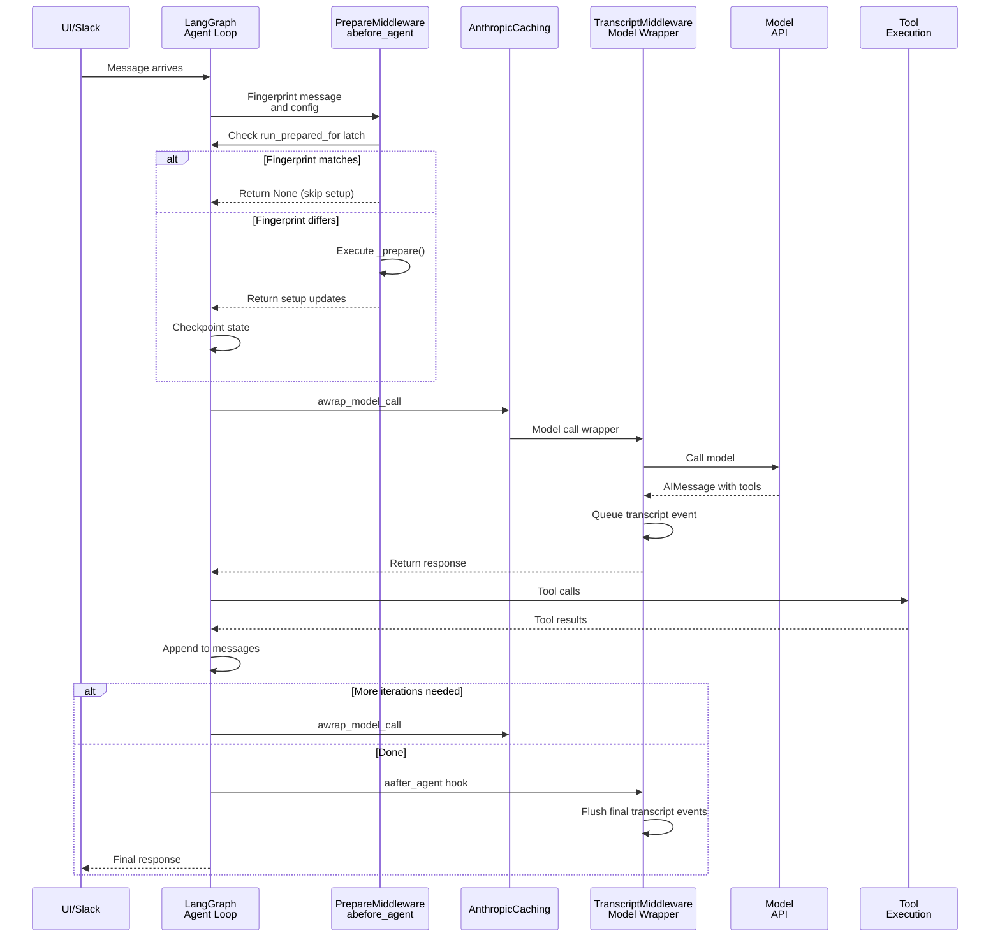

# Middleware Stack and Failure Boundaries

Managed Deep Agents (MDA) uses middleware to compose behavior around model calls, tool execution, and run lifecycle. Middleware is deployed through `RunKind` subclasses (`AgentKind` and `ReviewerKind`), which provide run-specific preparation middleware and access to shared infrastructure middleware. This separation allows middleware to be composed with deepagents' own middleware (filesystem, skills, tool dispatch) without modifying deepagents internals.

## Architecture overview

The middleware architecture layers as follows:

1. **OpenSWE middleware** (openswe/middleware/) provides run-specific, integration-specific, and observability middleware that shapes agent behavior, manages state, enforces policies, and integrates with external systems.

2. **LangChain middleware** (langchain.agents.middleware) provides core model and tool lifecycle hooks that OpenSWE middleware wraps around.

3. **DeepAgents framework** (deepagents) assembles the middleware stack into a runnable graph, providing filesystem tools, skills management, tool execution, and message ordering.

The `RunKind.preparation()` method returns a list of `AgentMiddleware` that gets merged into the graph at runtime. Each middleware instance can hook into before-agent, model-call wrapping, tool-call wrapping, and after-agent phases.

See [Coding Agent Assembly](agent-graph.md) and [Sandbox Lifecycle](sandbox-lifecycle.md) for the graph structure and sandbox contexts.

## Run-setup middleware: Preparation and state initialization

### BasePrepareRunMiddleware and the checkpoint-latch pattern

`BasePrepareRunMiddleware` defines a framework for checkpointed, idempotent per-run setup. Subclasses implement `_prepare()` to refresh tokens, resolve diffs, compute prompts, or other per-run initialization. The middleware fingerprints the latest message, its own class name, and subclass-provided configuration:

- On first invocation, it executes `_prepare()`, stores the fingerprint in `run_prepared_for`, and checkpoints the state.
- On resume of the same invocation (same fingerprint), the `run_prepared_for` latch skips setup.
- On a new message on the same thread (fingerprint changes), setup re-runs, allowing fresh token refresh and re-derived context.
- **Preparation must be idempotent**: failures before the checkpoint can cause re-execution, so all operations must tolerate that.

`PrepareRunState` extends `AgentState` with checkpoint fields:
- `run_prepared`: Boolean latch set to `True` after setup completes
- `run_prepared_for`: SHA256 fingerprint of `{"middleware": class name, "message": latest message fingerprint, "config": subclass config}`
- `rendered_system_prompt`: System prompt injected into model calls
- `rendered_workspace_prompt` and `rendered_thread_prompt`: Components of the final prompt
- `system_prompt_fixed`: Whether the thread's prompt is final (once set, pre-thread prompts are not re-rendered)

Subclasses include `PrepareAgentRunMiddleware` (coding agent) and `PrepareReviewerRunMiddleware` (reviewer).

### TranscriptMiddleware: State management and background writing

`TranscriptMiddleware` captures model calls, tool execution, and reasoning for debugging and auditing. Per-run state is managed by a module-level registry keyed by `thread_id:run_id` (stored in `_runs` dict) because **LangGraph runs each node in its own copied context** where `ContextVar` values set in one node are invisible to later nodes.

The `_namespace` `ContextVar` is the exception: it travels downward into nested graph invocations (subagents) from within tool coroutines, allowing nested tool execution to be recorded under the enclosing task namespace.

**Background writing ensures the model stream never waits on database I/O**: Events are queued and written by a background writer per run (asyncio task per `RunState`). Transcript failures are logged and swallowed so a transcript problem can never fail a run.

## Tool-related middleware: Tool visibility and execution safety

### ExcludeToolsMiddleware

Filters disallowed tool names from model requests. Hides tools the model should never see (e.g., admin tools, test tools).

### DynamicToolMiddleware

Exposes configured integration groups (MCPs, Notion) lazily: tool names are visible to the model up front, but actual tools are built only after the model requests them. Positioned after model-call wrapping to avoid loading integrations during fallback retries.

### Shell execution guards

**`PullRequestCreationGuardMiddleware`** (in tool execution layer, not main middleware list)

Blocks `execute` and `background_execute` command forms that create pull requests outside `open_pull_request`, including GitHub CLI, API, curl, and nested bash constructs. Returns a tool error instead of executing. Not installed for local/desktop runs.

**`WorkflowPushGuardMiddleware`** (in tool execution layer, not main middleware list)

Blocks push changes to `.github/workflows` files without recorded human approval. When `execute` or `background_execute` tool calls contain a `git push` command targeting `.github/workflows` files:

1. **Detection**: Parses shell commands and detects `git push` operations targeting `.github/workflows/`.
2. **Diff inspection**: Queries the sandbox for the diff between base and head commits.
3. **Fingerprinting**: Computes a SHA256 fingerprint from the diff content, ensuring only exact push changes are approved.
4. **Approval check**: Checks the database for a prior approval record matching the fingerprint.
   - If approved, executes the original `git push` command.
   - If pending or never seen, posts a Slack approval request **once per unique fingerprint** (marked `notified` after posting).
   - If rejected, returns a user-facing error message.
5. **User approval**: The approval URL directs the user to a dashboard link that records consent, tied to the fingerprint and thread.
6. **Resume behavior**: On the next model call, the approval check re-runs and sees the stored approval, then executes the push.

## Flow-control and policy middleware

**`RequireUserReplyMiddleware`**

Ensures the user has provided explicit feedback via a configured reply tool before the agent continues, blocking premature self-iteration.

**`RequireCliResultMiddleware`** (conditional, only if CLI thread)

Ensures CLI output is available before continuing, used for bridged CLI invocations.

**`TaskCoordinationMiddleware`** (conditional, only if worker mode active)

Coordinates task delegation to async worker processes, managing task lifecycle and status tracking for background execution.

**`IncidentMiddleware`** (conditional, only if incident session active)

Adapts run policy (e.g., model call limits) and tools when an incident is being actively tracked, enabling focused incident response workflows.

## Observer and bookkeeping middleware: Logging, usage tracking, and notifications

### record_run_usage (after-agent hook)

Persists summarized token usage for a run with a preparation-run ID and schedules deferred cost enrichment. Bookkeeping failures are caught and do not alter the agent result. Implemented as `RecordRunUsageMiddleware`.

### notify_step_limit (after-agent hook)

Recognizes the `ModelCallLimitMiddleware` marker (from langchain) and posts an explanatory Slack message when the agent hits its step limit.

### settle_review_check (after-agent hook, reviewers only)

Closes an unpublished tracked reviewer check as neutral so an incomplete review is not presented as a PR code failure. If `publish_review` completed but its conclusion PATCH failed transiently, the hook retries the stored pending real conclusion.

### RepairOrphanedToolCallsMiddleware (reviewers only)

Inserts synthetic error `ToolMessage` results for tool-call IDs that have no corresponding result before model calls. Prevents permanently wedged reviewer threads when runs are interrupted mid-tool-call.

## Other middleware

**`AnthropicPromptCachingMiddleware`** (from langchain_anthropic)

Optimizes Anthropic model calls by caching the system prompt and file context to reduce token usage and latency for multi-turn interactions. Always installed.

**`ModelCallLimitMiddleware`** (from langchain.agents.middleware)

Enforces a per-run limit on model calls. When exhausted, it terminates the agent and injects a marker message. `notify_step_limit` recognizes this marker and posts a Slack notification.

**`ModelErrorMiddleware`**

Logs and classifies model-call exceptions, recording the error type and classification code in thread metadata when context is available. Re-raises the original exception unchanged, preserving the error category for completion handling.

## Coding-agent preparation middleware

The coding agent's preparation middleware is returned by `AgentKind.preparation()`:

1. **`PrepareAgentRunMiddleware`**: Resolves the run context (diffs, tokens, participants, instructions), renders the system prompt, and sets up work directories.

2. **`ReviewGuideMiddleware`** (conditional, if review guide present): Adapts instructions and reply options when a code review walkthrough is active.

The middleware list is type-invariant in state schema: all middleware must be compatible with the same state type, which is the most general type they collectively require.

## Reviewer preparation middleware

The reviewer's preparation middleware is returned by `ReviewerKind.preparation()` and is simpler than the coding agent:

1. **`PrepareReviewerRunMiddleware`**: Loads the PR diff, resolves reviewers models (main and subagent), and prepares the review prompt. Deterministic repo prep (single clone-or-fetch + checkout) before the first model call avoids token burn on git commands.

After preparation, the reviewer graph installs a leaner middleware set assembled by the deepagents runtime, including `TranscriptMiddleware`, `record_run_usage`, caching, and error handling. Reviewers omit conversation offloading, incident adaptation, client tools, task coordination, model selection, dynamic tools, and shell guards.

## Middleware ordering and composition

### Coding agent middleware stack

From `AgentKind.reporters` and `AgentKind.preparation()`:

1. **Preparation phase** (`preparation()` hook):
   - `PrepareAgentRunMiddleware`
   - `ReviewGuideMiddleware` (optional, if active)

2. **Reporters** (installed after graph factory):
   - `TranscriptMiddleware` (singleton instance)
   - `record_run_usage` (singleton instance)

3. **Shell guards** (tool-execution middleware):
   - `PullRequestCreationGuardMiddleware`
   - `WorkflowPushGuardMiddleware`

### Reviewer middleware stack

From `ReviewerKind.reporters` and `ReviewerKind.preparation()`:

1. **Preparation phase** (`preparation()` hook):
   - `PrepareReviewerRunMiddleware`

2. **Reporters** (installed after graph factory):
   - `TranscriptMiddleware` (separate singleton from coding agent)
   - `record_run_usage` (separate singleton from coding agent)

3. **No shell guards** for reviewer

### DeepAgents composition layer

The middleware list is merged with deepagents' own middleware, which provides:

- **FilesystemMiddleware**: Exposes file read/write/delete and directory navigation tools, backend-specific for local vs. sandboxed runs.
- **SkillsMiddleware**: Loads and exposes skills from configured sources.
- **Core tool execution**: Handles tool call dispatch, error handling, and result collection.
- **Message ordering**: Ensures stable, deterministic tool result ordering.

The openswe middleware wraps around these layers, allowing openswe to observe and shape model calls, manage state, enforce policies, and integrate external systems without modifying deepagents internals.

## State checkpointing and resumption

The preparation flow follows a checkpoint-and-latch pattern:

1. `RunKind.preparation()` returns a list of middleware.
2. The graph factory merges preparation middleware with runtime middleware.
3. On the first agent invocation, `abefore_agent()` runs:
   - Compute fingerprint from latest message, class name, and subclass config
   - If `run_prepared_for` matches the computed fingerprint, return early (resume same invocation)
   - Otherwise, execute `_prepare()`, collect updates dict
   - Return `{"run_prepared": True, "run_prepared_for": fingerprint, **updates}`
4. LangGraph checkpoints this state after the before-agent node.
5. Subsequent middleware use the checkpoint fields (`rendered_system_prompt`, etc.) in their model-call wrappers.

**Idempotency requirement**: A failure before the checkpoint can cause re-execution. Setup typically refreshes authorization tokens, loads diffs for reviewers, or resolves model-specific parameters. After an in-checkpoint failure and resume, the latch prevents preparation from running again as long as the fingerprint matches.

## Message processing pipeline



Per-run pipeline from message arrival through model and tool loops to completion.

## Tool execution guard flow

<!-- openwiki: mermaid parse failed and this diagram was converted to a text fence so it does not break rendering. Fix the diagram source and restore the mermaid fence. Parser error: Heuristic: an unescaped angle bracket inside a label breaks rendering; rephrase the label. -->
```text
flowchart TD
    A["Tool call to execute<br/>or background_execute"] --> B{"Is it git push<br/>to .github/workflows?"}
    B -->|No| C["Execute normally"]
    B -->|Yes| D["Parse diff"]
    D --> E["Compute SHA256<br/>fingerprint"]
    E --> F["Check database<br/>for approval"]
    F -->|Approved| C
    F -->|Pending/Unknown| G["Post Slack approval<br/>request with diff"]
    G --> H["Mark as notified"]
    H --> I["Return blocked<br/>ToolMessage"]
    F -->|Rejected| I
    I --> J["Agent resumes<br/>on next model call"]
    J --> F
    C --> K["Execute command"]
    K --> L["Return result"]
```

Workflow push guard approval and execution flow.

## Failure boundaries and safety invariants

### Transcript and observability failures never crash runs

`TranscriptMiddleware` treats all transcript operations as observability: database writes are queued to a background task per run, write failures are logged and swallowed, and transcript unavailability never alters agent results. This ensures that infrastructure problems (database outages, storage limits) do not interrupt active work.

### Approval permanence and finality

`WorkflowPushGuardMiddleware` fingerprints the push diff to ensure approval is specific to the exact changes. Only exact matching of the fingerprinted diff allows the push to proceed; any workflow change causes a new approval prompt. Changes inherited from a merged base branch are noted separately in the diff preview, so reviewers can approve merged parent workflows without re-approving feature-branch modifications.

### Sandbox resilience strategy

**Reviewer sandbox setup** opts into replacement (`abandon_unreachable=True`) because its checkout is re-derived for each run and a persistent PR thread should not be bricked by a dead sandbox. The checkout is deterministic (single clone-or-fetch + checkout), so a new sandbox does not lose work.

**Coding agent sandbox setup** deliberately does not auto-replace (`abandon_unreachable=False`) to avoid concealing loss of uncommitted work. If a sandbox becomes unreachable, the agent can surface the error to the user so they can decide whether to save work or abandon it.

### Per-run idempotency

`BasePrepareRunMiddleware` and its subclasses achieve per-run idempotency by fingerprinting the message and configuration. This allows:

- Checkpointed setup to survive transient failures before the checkpoint
- Resumed runs with the same fingerprint to skip setup entirely
- Fresh re-preparation when the message or configuration changes

All preparation operations must tolerate re-execution because a failure before checkpoint persistence can cause a retry.

## Integration with DeepAgents

The middleware list passed to the graph is merged with deepagents' own middleware. OpenSWE middleware wraps around deepagents' layers, allowing openswe to observe and shape model calls, manage state, enforce policies, and integrate external systems without modifying deepagents internals.

## Message preparation and sanitization

Before each provider call, message sanitizers (from langchain and openswe) prepare provider-specific message formats and clean unsupported content blocks. Stable tool result ordering (from deepagents) ensures tool results are ordered stably and deterministically across message lists, allowing the model to rely on consistent result positions.
