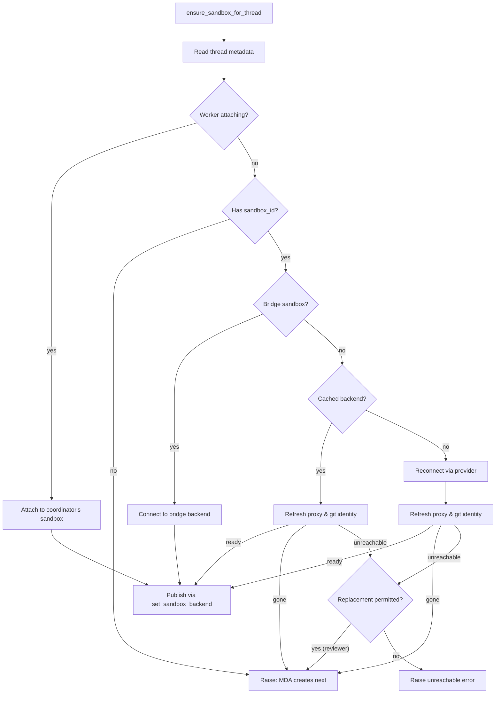

# Thread Sandbox Lifecycle

A normal agent thread has one durable sandbox binding: the sandbox contains its checkout and uncommitted working tree across runs. Managed Deep Agents (MDA) creates every thread's sandbox; the backend reconnects to an existing box, refreshes its proxy credentials, or hands the thread to MDA when one is deleted or must be replaced. The binding is deliberately split between durable thread metadata and a worker-local handle, letting a later run on another worker reconnect while avoiding exposing a partially initialized sandbox to tools.

Related: [Threads and state](../concepts/threads-and-state.md), [Auth and security](../concepts/auth-and-security.md), and [Sandbox providers](../integrations/sandbox-providers.md).

## Binding and handles

`thread.metadata["sandbox_id"]` is the durable identity of a sandbox. `get_sandbox_metadata` reads the live LangGraph thread; a lookup failure returns `{}`, hence no ID. That fail-open behavior is safe for reading but is why backend code never deletes a sandbox keyed from this metadata: an unreliable lookup must not delete a live working tree.

`SANDBOX_BACKENDS` is an in-process dictionary from thread ID to a stable `SandboxBackendProxy`. It is a cache, not persistence, and disappears with a worker restart. `SANDBOX_CONNECTIONS` is keyed by *sandbox* ID rather than thread ID, so a thread rebound on another worker cannot be handed a stale connection from its previous worker. `set_sandbox_backend` retains the existing proxy and swaps its target when possible, so middleware and tools holding the proxy see a replacement backend instead of retaining a stale object. When the sandbox ID changes, the old connection is unpublished from the keyed registry.

The proxy is asynchronous-only. Synchronous backend methods raise `NotImplementedError`; its `a*` methods resolve the current backend before delegating. If it has no target, resolution uses a registered reconnect callback, or falls back to the metadata ID and `connect_existing_sandbox`. A lock and shared startup task collapse concurrent first operations to one reconnect; `asyncio.shield` means cancellation of one waiter does not cancel shared startup. The proxy subclasses `BaseSandbox` so filesystem tooling recognizes capture-at-source support and can preserve the in-sandbox output cap. If an underlying backend lacks execute-offload support, the proxy explicitly falls back to ordinary execution. The `ready()` contract exposes `_aget_backend()` so callers can await a fully resolved backend without executing a command.

## Sandbox ownership and reconnection

Managed Deep Agents creates and owns every thread's sandbox. The backend never creates one; instead:

1. **Cached**: reuse a live cached backend if one exists for this thread in this process.
2. **Reconnect**: if metadata holds a sandbox ID, reconnect to it using the provider.
3. **Handed to MDA**: if the thread has no ID, MDA will create the box when its run starts and bind the thread before preparation.

For LangSmith sandboxes, reconnection also refreshes proxy configuration (GitHub credentials and tool access) and reapplies git identity. Bridge sandboxes (the user's local machine) skip both provisioning and proxy configuration.

The flow is recorded in `ensure_sandbox_for_thread`, which is the lifecycle entrypoint. Thread dispatch uses `multitask_strategy="interrupt"`, so one thread does not provision two sandboxes concurrently and no cross-process sentinel is used.

*Thread sandbox selection, bridge detection, reachability check, MDA handoff, and final publication.*

### Bridge sandbox connection

Desktop runs (via the Open SWE CLI) use `BridgeSandboxBackend`, which communicates with a user's local machine through long-poll requests. The backend detects bridge sandboxes by ID prefix and connects without provisioning. A disconnected bridge raises `SandboxUnreachableError` and is never replaced because the entire sandbox is the user's checkout.

### Reconnection and reachability

Reuse has no separate ping: for LangSmith, refreshing proxy configuration necessarily reaches the box, so that real operation is the reachability check. Git identity is re-applied every run because a reused box can lose its global config and commit authors must remain valid for downstream preview deployments. Identity configuration starts concurrently with proxy configuration because it requires the box but not proxy credentials.

## Gone vs. unreachable

Recovery is intentionally data-preserving:

- `SandboxGoneError` means the provider confirms the bound box no longer exists (e.g., LangSmith's `ResourceNotFoundError`). It cannot contain the working tree, while its stale metadata ID would make every future run reconnect to the same missing resource. The thread is handed to MDA: unbound, its next run starts in MDA's box rather than reconnecting to the deleted one.
- `SandboxUnreachableError` means this run could not connect or reconfigure a box. The next run may succeed against the same ID. The default behavior is to raise rather than replace: silently switching to an empty filesystem could discard uncommitted work while the agent still believes that work exists. A failure while attempting to hand the thread to MDA is normalized to `SandboxUnreachableError`, preserving the caller's recovery contract.
- `abandon_unreachable=True` is reserved for callers whose sandbox holds only a re-derivable checkout — the read-only reviewer and review scout. Reviewer sandboxes hold only a checkout that `prepare_review_repo` clone-or-fetches and force-checks out to the PR head on every run, so an unreachable box can safely be replaced.

A command-level failure is not automatically a sandbox failure. The tool error path distinguishes pre-command transient gateway failures, which tell the model to retry, and command error frames, which remain normal tool errors. A non-transient connection failure notifies the user once and terminates the run rather than repeatedly executing against a dead backend.

## LangSmith credential proxy

GitHub authentication is injected at the sandbox proxy level, not exposed in the sandbox environment. On sandbox connection and reuse, lifecycle code resolves either a supplied GitHub token or a GitHub App installation token, then configures the LangSmith proxy. GitHub credentials are injected as opaque request headers: `api.github.com` receives `Authorization: Bearer`, while `github.com` and `*.github.com` receive Basic authentication for `x-access-token:<token>`. The sandbox sees only the `GH_TOKEN=proxy-injected` placeholder required by `gh`; the real GitHub token is not written into its environment or filesystem.

Environment-provided proxy configuration is retained as a base configuration. It is persisted in thread metadata as `sandbox_base_proxy_config` after successful connection or creation, so reconnects and token rotations preserve custom rules. The configuration procedure preserves custom rules, retires credentials from removed built-in integrations, and may add opaque tool-access rules. A proxy PATCH retries retryable transport/status errors. If it receives `SandboxNotReadyError` (when the LangSmith SDK provides it), it best-effort starts the stopped sandbox and retries; a stopped box retains its filesystem and is not equivalent to a deleted one.

GitHub App tokens expire after one hour. `record_proxy_token_expiry` keeps worker-local expiry, recorded time, repository scope, permission scope, and base proxy configuration per thread. The before-model middleware `refresh_github_proxy_before_model` invokes `maybe_refresh_proxy_token`; it refreshes within five minutes of known expiry or after 50 minutes when expiry is unknown. Refresh remints with the original recorded scope unless a caller supplies a scope, so ordinary rotation does not broaden repository access or permissions. The middleware logs refresh failures rather than preventing a model call.

## MDA handoff operations

When a thread's backend-owned sandbox is deleted or must be replaced, it is handed to MDA. The thread's next run starts in an MDA-created box from the specified workspace or base snapshot. MDA owns that box and replaces it through MDA's own mechanisms when needed.

`hand_sandbox_to_mda` stops the old backend-owned sandbox (best-effort) and unbinds the thread, leaving a record of what MDA should recreate from. If the old box exists and its stop is needed, the error is captured so the binding is atomic even if the stop could not be confirmed. The thread remains recoverable because the binding is only cleared after the metadata update succeeds.

`hand_gone_sandbox_to_mda` unbinds a deleted sandbox before the run is planned, so the run starts in MDA's box rather than failing on the missing one.

When MDA creates and binds a replacement, `bind_mda_sandbox` marks the thread as MDA-owned and records the new sandbox ID. The lifecycle then connects to that box, configures its proxy, and publishes it as usual.

## Repository paths and reviewer preparation

Provider filesystems do not share a universal root. `resolve_sandbox_work_dir` first tries provider-exposed work-directory methods, then shell `pwd`, provider home/root methods, and finally `$HOME`; each candidate must exist and be writable. The resolved path is cached on the backend, and `resolve_repo_dir` appends a validated repository name or returns the checkout itself for bridged runs. This keeps repository operations portable across provider wrappers.

The reviewer prepares its repo before the first model call: it clones once or fetches an existing checkout, fetches the PR head and base as needed, force-checks out the requested head SHA, and verifies `HEAD`. Preparation is best-effort, returning `False` on failure so the review can proceed from its fetched diff. Reviewer skills are treated separately: skill directories are extracted from the trusted base reference into `.review-skills` outside the PR checkout, never loaded from attacker-controlled PR-head content.

## LangSmith configuration and startup

`validate_sandbox_startup_config` validates the active LangSmith configuration at server startup rather than deferring errors until the first sandbox connection. It checks numeric size and retention settings, rejects negative TTLs, and validates `SANDBOX_CREATE_EXTRA_JSON` when present.

For LangSmith sandboxes, `LangSmithCreateOptions.resolve` carries environment resource settings and create parameters. Command retry is conservative: only `SandboxRetryableConnectionError`, which guarantees the WebSocket upgrade failed before the command frame was sent, may be retried. Retries are bounded at four attempts with exponential jittered backoff, preventing a potentially executed command from being double-run.

## Focused verification

The sandbox test suite exercises LangSmith proxy payloads and retries, thread binding order, gone/unreachable recovery, proxy token refresh scope, paths, reviewer preparation, bridge connection, and handoff to MDA. In particular, tests assert concurrent proxy callers reconnect only once, MDA ownership blocks backend replacement, gone boxes are handed over, and retryable gateway errors are retried only when the SDK guarantees no command ran.
