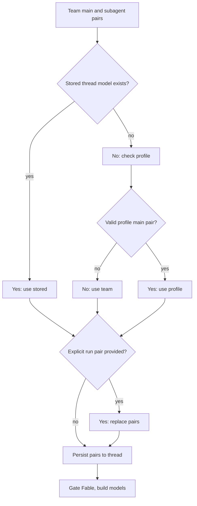

# Models, Profiles, and Instructions

A hosted agent run resolves a valid `(model_id, effort)` pair and a thread-stable repository-instruction value before it builds models. The triggering user's identity, credentials, PR preference, and personal instructions are deliberately re-evaluated for each message. This split lets a multi-party, long-lived thread keep its operational choices while avoiding attribution of one participant's preferences to another.

## Model registry and stale selections

`SUPPORTED_MODELS` is the curated selectable-model registry. Each `ModelOption` contains the provider-prefixed id, label, allowed `efforts`, `default_effort`, image capability, and, where applicable, whether it may be saved as a default. `SUPPORTED_MODEL_IDS` is the membership set used during resolution. Effort is not a global enum: for example, Kimi K3 accepts only `low`, `high`, and `max`; Gemini 3.8 Flash uses `minimal` through `high`. Always validate a pair with `model_supports_effort`, and validate multimodal input with `model_supports_images`.

The dashboard's `/options` response does not mutate this registry. It returns copied records from `available_requested_models`, which filters by Fable enablement. Those records are enriched with context-window information, preferring explicit Codex overrides, then a LangChain provider profile, then a small fallback table. The response also gates returned defaults by Fable settings: when Fable is disabled, any Fable default is replaced with its non-Fable fallback before advertising.

### Defaults and recovery

`default_model_pair()` is the deployment-level terminal default. It reads `LLM_MODEL_ID` and `LLM_REASONING_EFFORT`, with credential-sensitive built-in fallbacks. The selected default must be a supported, default-eligible model and support its effort; otherwise it raises `ValueError` rather than constructing an arbitrary model. Local development startup separately validates the credential required by the configured default.

A selection that has fallen out of the registry is handled differently from one explicitly listed in `DEPRECATED_MODEL_IDS`:

* For a non-deprecated id, `provider_fallback_pair` chooses the first supported model on the same provider, preferring the same Claude family. It preserves effort where supported (including mapping Gemini `none` to `minimal`) and otherwise uses the fallback model's default effort. An unknown provider yields no pair. A retired id in `RETIRED_MODEL_REPLACEMENTS` moves to its named successor.
* Deprecated ids are excluded from that recovery path and defer to a team or deployment default. `DEPRECATED_MODEL_REPLACEMENTS` currently contains empty values and returns `None` for deprecated ids; there is no automatic canonical migration.

All team default resolvers via `_resolve_default_pair` use a valid saved pair first, then same-provider recovery, then `default_model_pair()`. This is the invariant that stale persisted settings still produce a constructible pair.

## Precedence, roles, and thread lifecycle

Team settings are a single LangGraph Store record keyed `"default"` in `["team_settings"]` (historically called "team settings" in the pre-workspaces architecture). Reads overlay non-null stored fields over hardcoded defaults and fail soft to those defaults on store failure. The team can set main and subagent pairs for agent and reviewer roles; review chat inherits the agent pair when its own pair is absent or invalid, and diff grouping inherits the reviewer subagent pair. Thread-title selection has a separate default and can switch an OpenAI title model to Haiku on an Anthropic-only deployment with neither gateway routing nor desktop OpenAI OAuth.

Per-user profiles are stored in the LangGraph Store in the `["profiles"]` namespace, keyed by GitHub login. A profile holds a main model pair, optional subagent pair, default repository and branch preferences, PR/CI preferences, and model-routing and UI feature flags. Profile writes are kept separate from encrypted OAuth records in the `["oauth_tokens"]` namespace, preventing concurrent profile saves and token refreshes from overwriting each other's fields.

*Caption: Model selection precedence from team defaults through stored thread snapshot to explicit per-run override.*

For a hosted agent run, `agent_catalog` (in `openswe.server`) is the factory that seeds the initial run from team defaults. Its model resolution path is:

1. Start with workspace team defaults (main and subagent pairs resolved via `settings.default_model_pair("agent")`).
2. If no stored thread model exists, apply the profile only: read the sender's profile via `load_profile` (fail-soft) and use its main and subagent pairs if valid.
3. If stored thread settings exist, use them instead, overriding both team and profile.
4. If explicit per-run `cfg.agent_model_id` and `cfg.agent_effort` are supplied (and valid), replace both pairs and persist them immediately via `store_thread_settings`.

`agent_settings` lives in thread metadata under the `THREAD_SETTINGS_KEY` constant, is cached for five minutes by `load_thread_settings`, accepts only its typed fields via `ThreadSettings`, and reads or writes fail soft; malformed legacy metadata becomes an empty snapshot via `normalize_thread_settings`.

For selection-only callers, `resolve_agent_model_id` applies supported per-thread id, then valid profile id, then team default. Dashboard run creation uses the full pair in the order team, profile, request. A deprecated request intentionally leaves the team default, rather than allowing the profile to take effect. If dashboard input contains images, a text-only resolved selection is replaced with `default_vision_model_pair()`; direct image-content construction rejects a missing or text-only model with HTTP 422.

Fable is a workspace-wide ZDR gate. A Fable option cannot be saved as a normal default, and disabling Fable rewrites submitted Fable team defaults to a non-Fable Anthropic fallback. `gate_fable_model` is also applied after snapshot resolution to main, subagent, and title models, and by dashboard resolution and option listing. Thus a stale snapshot cannot cause a disabled Fable model to be advertised or constructed.

### Adaptive model routing

When `model_routing_enabled` is true at the workspace level, the factory seeds fast, balanced, and performance routing variants alongside the main model. Each variant pair is resolved through the same precedence rules (team defaults, profile overrides, thread snapshot) and may differ from the main model. A thread's routing arm is determined by a stable hash of its id against a 50% threshold, allowing the experiment to split threads between routed and non-routed control arms. The router uses input characteristics to select between fast and balanced paths; performance routing is reserved for explicit high-effort requests and incident modes. The `RoutingArm` class stabilizes thread assignment, and routing decisions are re-evaluated on each turn; a non-routed thread runs the person's explicit or inherited selection unchanged.

## Provider construction, reasoning, gateway, and runtime fallback

Provider-level model construction is handled by `make_model` in `runtime_api.models`, which:

- Constructs through LangChain's `init_chat_model` with a default max_retries of 6 and a 600-second per-request timeout for shipped provider prefixes.
- Configures OpenAI models for the Responses API with `store=False`, `output_version="responses/v1"`, and included encrypted reasoning; if gateway routing is not applied and no `OPENAI_API_KEY` exists, desktop OAuth can provide the model instead.
- Routes Baseten as an OpenAI-compatible provider and, when the gateway is disabled, requires `BASETEN_API_KEY` and points at the Baseten base URL, raising if the key is missing.
- Applies provider-specific effort parameter handling: OpenAI receives `reasoning` and uses `summary: "auto"` except for `none`; Anthropic receives adaptive, summarized `thinking` and an `effort`; Gemini 3 family models receive `thinking_level`; Fireworks receives `model_kwargs.reasoning_effort`; and Baseten receives `reasoning_effort` only for `low`, `high`, or `max`.
- Caches models by model id, requested gateway value, max tokens, frozen kwargs, and event-loop id.

Gateway enablement is tri-state: a `True` or `False` team value wins, while `None` inherits `LANGSMITH_GATEWAY_ENABLED` (or the presence of a dedicated gateway key if that variable is unset). When routing is possible, `gateway_overrides` supplies base_url/api_key/use_responses_api that override direct-provider defaults. A non-routable provider or absent LangSmith key is logged and remains direct rather than failing the run.

Provider request routing is distinct from runtime model fallback. `ModelFallbackMiddleware` uses `LLM_FALLBACK_MODEL_ID` when set; otherwise Anthropic primaries fall back to OpenAI and OpenAI primaries to Anthropic. `fallback_model_id_for` returns a cross-provider fallback and `None` for Google/local/self-hosted providers that must not be silently re-routed.

## Instruction sources and authority

Repository custom instructions are workspace-admin-authored records in a database table, normalized by owner/name (case-insensitive). On a new hosted thread the factory resolves instructions for the effective default repository via `get_repo_agent_instructions` and saves the text in the thread snapshot. `construct_system_prompt` renders it as **Repository-specific Custom Instructions**, so it is shared by the thread; if lookup fails, that section is absent rather than aborting the run.

Personal instructions are separate LangGraph Store records in the `["user_instructions"]` namespace, keyed by GitHub login, and capped at 20,000 characters. They can be changed from the dashboard or by the agent's `save_user_instructions` tool, so keeping them out of the profile avoids competing writers. During prepare-run, the factory loads the triggering user's current text and makes it available to the message-construction system as `standing_instructions` in the sender's `PersonIdentity` block. It explicitly applies to that turn only and is rendered into the message context rather than the shared system prompt.

Prompt authority is explicit:

1. A repository `AGENTS.md`, if present, overrides prompt defaults with the same authority as the system prompt.
2. Repository-specific custom instructions are mandatory but yield to `AGENTS.md`.
3. Sender-level personal instructions yield to repository instructions and `AGENTS.md`.

In particular, user instructions are not shared thread instructions and must not override repository policy.

## Prompt loading, instruction caching, and rendering

Prompts are Jinja2 templates and static Markdown files loaded from `agent/resources/prompts/` via the `prompt()` function in `openswe/prompts.py`. Templates end with `.md.jinja` and accept keyword arguments that become Jinja variables. The main system prompt is constructed in `construct_system_prompt`, which assembles sections for working environment, dashboard context, source guidance, repository scope, collaboration, external comments, repository instructions, workspace settings, and recent thread context. Each section is conditionally rendered and only included if its content is non-empty.

Repository custom instructions are rendered into a dedicated section via `_render_repo_instructions_section`. Workspace instructions are rendered via `_render_workspace_section` and include org-level guidelines and workspace-specific repos. User (sender-level) instructions do not appear in the system prompt; instead, they are placed in the message context as `standing_instructions` on the sender's `PersonIdentity` block in `openswe/input_messages.py`. This ensures they apply only to the sender's current turn, not thread-wide, and allows per-message re-evaluation of personal preferences.

`SystemPrompt` is split into three frozen layers—`shared`, `workspace`, and `thread`—to enable efficient prompt caching. The shared layer changes only across deployments; the workspace layer changes for each workspace; the thread layer changes for each thread. Only the thread layer contains thread-specific identity and artifact links, minimizing cache misses.

Instruction caching leverages Anthropic's prompt caching middleware (`AnthropicPromptCachingMiddleware`), configured with a 1-hour TTL on read-only graph models to enable efficient multi-turn conversations by caching the stable portions of the system prompt and instructions, reducing token consumption and latency for subsequent turns in the same thread.

## Change and test guide

When changing the registry, fallback, or profile normalization, exercise `tests/models/test_model_fallback_resolution.py`: it covers provider-preserving recovery, deprecated-id deferral, environment defaults, profile/team behavior, context enrichment, and Fable handling. Dashboard thread tests cover team/profile/request precedence and image validation/fallback. `agent/test_thread_settings.py` covers typed snapshot normalization, caching, and fail-soft persistence. Update these focused cases when adding a provider, changing an effort set, or altering precedence.
