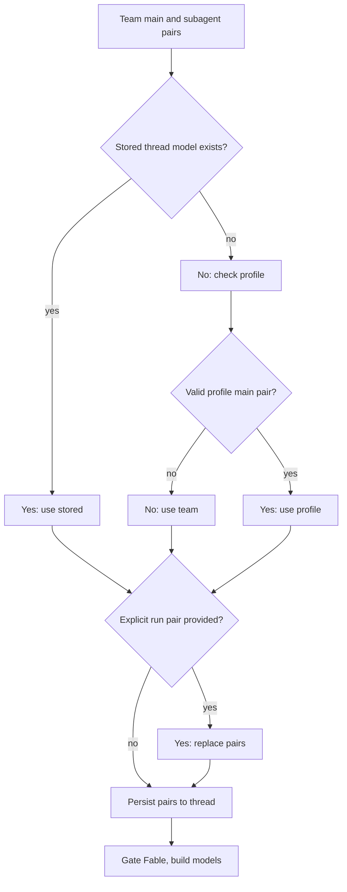

# Models, Profiles, and Instructions

A hosted agent run resolves a valid `(model_id, effort)` pair and a thread-stable repository-instruction value before it builds models. The triggering user's identity, credentials, PR preference, and personal instructions are deliberately re-evaluated for each message. This split lets a multi-party, long-lived thread keep its operational choices while avoiding attribution of one participant's preferences to another.

## Model registry and stale selections

`SUPPORTED_MODELS` is the curated selectable-model registry. Each `ModelOption` contains the provider-prefixed id, label, allowed `efforts`, `default_effort`, image capability, and, where applicable, whether it may be saved as a default. `SUPPORTED_MODEL_IDS` is the membership set used during resolution. `NON_DEFAULT_MODEL_IDS` is a frozen set of model ids that have `can_be_default: False` and cannot be selected as workspace or profile defaults (e.g., Fable models must be explicitly opted into at the workspace level before users can choose them). Effort is not a global enum: for example, Kimi K3 accepts only `low`, `high`, and `max`; Gemini 3.8 Flash uses `minimal` through `high`. Always validate a pair with `model_supports_effort`, and validate multimodal input with `model_supports_images`.

The dashboard's `/options` response does not mutate this registry. It returns copied records enriched with context-window information from `model_profile_context_window()`, preferring explicit Codex overrides via `CODEX_CONTEXT_WINDOW_OVERRIDES`, then a LangChain provider profile loaded from the provider's profile module, then a fallback table `_PROFILE_CONTEXT_WINDOW_FALLBACKS`. It removes Fable choices when the workspace switch is off and gates returned defaults as well.

### Defaults and recovery

`default_model_pair()` is the deployment-level terminal default. It reads `LLM_MODEL_ID` and `LLM_REASONING_EFFORT`, with credential-sensitive built-in defaults (Anthropic's Opus if the API key is available and OpenAI's is not; otherwise OpenAI's GPT-6.1 Sol) and `DEFAULT_MODEL_EFFORT` as fallbacks. The selected default must be a supported, default-eligible model (not in `NON_DEFAULT_MODEL_IDS`) and support its effort; otherwise it raises `ValueError` rather than constructing an arbitrary model. Local development startup separately validates the credential required by the configured default.

A selection that has fallen out of the registry is handled differently from one explicitly listed in `DEPRECATED_MODEL_IDS`:

* For a non-deprecated id, `provider_fallback_pair` chooses the first supported model on the same provider, preferring the same Claude family. It preserves effort where supported (including mapping Gemini `none` to `minimal`) and otherwise uses the fallback model's default effort. An unknown provider yields no pair.
* Deprecated ids are excluded from that recovery path and defer to a team or deployment default. `DEPRECATED_MODEL_REPLACEMENTS` currently contains empty values and returns `None` for deprecated ids; there is no automatic canonical migration.

All team default resolvers use a valid saved pair first, then same-provider recovery, then `default_model_pair()`. This is the invariant that stale persisted settings still produce a constructible pair.

## Precedence, roles, and thread lifecycle

Team settings are a single LangGraph Store record keyed `"default"` in the `["team_settings"]` namespace. Reads overlay non-null stored fields over hardcoded defaults from `_default_settings()` and fail soft to those defaults on store failure. The team can set main and subagent pairs for agent and reviewer roles; review chat inherits the agent pair when its own pair is absent or invalid, and diff grouping inherits the reviewer subagent pair. Thread-title selection has a separate default (defaulting to OpenAI's GPT-6 Luna at low reasoning effort, or Anthropic's Opus on an Anthropic-only deployment).

Profiles in the `["profiles"]` namespace carry a main pair, optional subagent pair, default repository and branch preferences, PR/CI preferences, and model-routing and UI preferences. Profile writes are separate from encrypted OAuth records in the `["oauth_tokens"]` namespace, preventing concurrent profile saves and token refreshes from overwriting each other. Run-start profile lookup is fail-soft via `load_profile()`, while dashboard profile reads deliberately surface store failures via `get_profile()`.

*Caption: Model selection precedence from team defaults through stored thread snapshot to explicit per-run override.*

`build_agent` is the factory that seeds hosted runs from team defaults. It reads a sender profile only if the thread has no stored main model; a valid profile main pair also becomes the subagent pair unless a valid profile subagent pair is supplied. Stored thread settings then take precedence. Finally, a valid `cfg.agent_model_id` plus `agent_effort` (from explicit per-run override) replaces both pairs and is persisted. `agent_settings` lives in thread metadata via `store_thread_settings`, is cached for five minutes by `load_thread_settings`, accepts only its typed fields via `ThreadSettings`, and reads or writes fail soft; malformed legacy metadata becomes an empty snapshot via `normalize_thread_settings`.

For selection-only callers, `resolve_agent_model_id` applies supported per-thread id, then valid profile id, then team default. Dashboard run creation uses the full pair in the order team, profile, request. A deprecated request intentionally leaves the team default, rather than allowing the profile to take effect. If dashboard input contains images, a text-only resolved selection is replaced with `default_vision_model_pair()`; direct image-content construction rejects a missing or text-only model with HTTP 422.

Fable is a workspace-wide ZDR gate. A Fable option cannot be saved as a normal default (it is in `NON_DEFAULT_MODEL_IDS`), and disabling Fable via `fable_enabled: False` rewrites submitted Fable team defaults to a non-Fable Anthropic fallback via `fable_disabled_fallback()`. `gate_fable_model` is also applied after snapshot resolution to main, subagent, and title models, and by dashboard resolution and option listing. Thus a stale snapshot cannot cause a disabled Fable model to be advertised or constructed.

## Provider construction, reasoning, gateway, and runtime fallback

`provider_model_kwargs` translates the resolved effort at the provider boundary: OpenAI receives `reasoning` as a dict with `effort` and `summary: "auto"` except for `none`; Anthropic receives `thinking` (type `"adaptive"`, display `"summarized"`) and an `effort` field; Gemini 3+ family models receive `thinking_level`; Fireworks receives `model_kwargs["reasoning_effort"]`; and Baseten receives `reasoning_effort` only for `low`, `high`, or `max`.

`make_model` constructs through `init_chat_model` with six retries (via `DEFAULT_MAX_RETRIES`) and a 600-second timeout for shipped provider prefixes. It applies provider-specific request defaults from `model_request_defaults()`, preserving timeout overrides for long-context or high-effort requests (e.g., Gemini 4 Argon uses 900 seconds). OpenAI defaults to the Responses API with `store=False`, `output_version="responses/v1"`, and included encrypted reasoning via `_configure_openai_responses_kwargs()`; if gateway routing is not applied and no `OPENAI_API_KEY` exists, desktop OAuth can provide the model instead. Baseten is configured as OpenAI-compatible and, without gateway routing, requires `BASETEN_API_KEY` and its service URL. Models are cached by model id, requested gateway value, max tokens, frozen kwargs, and event-loop id.

Gateway enablement is tri-state: a `True` or `False` team value wins, while `None` inherits `LANGSMITH_GATEWAY_ENABLED` (or the presence of a dedicated gateway key if that variable is unset) via `resolve_gateway_enabled()`. When routing is possible, `gateway_overrides()` supplies base URL and API key overrides, and selects whether OpenAI uses Responses (controlled by `LANGSMITH_GATEWAY_OPENAI_USE_RESPONSES`, defaulting to `True` to support reasoning models with tool calls). A non-routable provider or absent LangSmith key is logged and remains direct rather than failing the run.

Provider request routing is distinct from runtime model fallback. `ModelFallbackMiddleware` uses `LLM_FALLBACK_MODEL_ID` when set; otherwise Anthropic primaries fall back to OpenAI and OpenAI primaries to Anthropic. Google, local, and self-hosted providers have no automatic cross-provider fallback via `fallback_model_id_for()`.

## Instruction sources and authority

Repository custom instructions are workspace-admin-authored records in the `["agent_instructions"]` namespace, keyed by `owner/name`. On a new hosted thread the factory resolves instructions for the effective default repository and saves the text in the thread snapshot. `construct_system_prompt` renders it as **Repository-specific Custom Instructions** in `_render_repo_instructions_section()`, so it is shared by the thread; if lookup fails, that section is absent rather than aborting the run.

Personal instructions are separate `["user_instructions"]` records keyed by GitHub login, capped at 20,000 characters. They can be changed from the dashboard or by `save_user_instructions`, so keeping them out of the profile avoids competing writers. During prepare-run, the factory loads the triggering user's current text via `_resolve_user_custom_instructions()` and makes it available to the message-construction system as `standing_instructions` in the sender's `PersonIdentity` block via `as_person()` in `authorship.py`. It explicitly applies to that turn only and is rendered into the message context rather than the shared system prompt.

Prompt authority is explicit:

1. A repository `AGENTS.md`, if present, overrides prompt defaults with the same authority as the system prompt.
2. Repository-specific custom instructions are mandatory but yield to `AGENTS.md`.
3. Workspace-level instructions (rendered via `_render_workspace_section()`) yield to repository instructions and `AGENTS.md`.
4. Sender-level personal instructions (via `standing_instructions`) yield to repository instructions and `AGENTS.md`.

In particular, user instructions are not shared thread instructions and must not override repository policy.

## Model pair concept and adaptive routing

Each role (agent, reviewer, chat) has a main model and optional subagent model. The subagent model is used for research, code search, and context-gathering subtasks, while the main model handles the user-facing response. A profile can override both pairs independently; when a profile provides only a main model, it becomes the subagent model unless an explicit subagent override exists.

When `model_routing_enabled` is true at the workspace or user level, the factory seeds fast, balanced, and performance routing variants alongside the main model. Fast uses GPT-6 Luna at high effort; balanced uses GPT-6.1 Sol at medium effort; performance uses GPT-6 Astra at low effort. Each variant pair is resolved through the same precedence rules (team defaults, profile overrides, thread snapshot) and may differ from the main model. The router uses input characteristics to select between fast and balanced paths; performance routing is reserved for explicit high-effort requests.

## Prompt loading, instruction caching, and rendering

System prompts are Jinja2 templates and static Markdown files loaded from `agent/resources/prompts/` via the `prompt()` function. Templates end with `.md.jinja` and accept keyword arguments that become Jinja variables. The main system prompt is constructed in `construct_system_prompt`, which assembles sections for working environment, dashboard context, source guidance, repository scope, collaboration, external comments, repository instructions, workspace settings, and recent thread context. Each section is conditionally rendered and only included if its content is non-empty.

Repository custom instructions are rendered into a dedicated section via `_render_repo_instructions_section`. Workspace instructions are rendered via `_render_workspace_section` and include org-level guidelines and workspace-specific repos. User (sender-level) instructions do not appear in the system prompt; instead, they are placed in the message context as `standing_instructions` on the sender's `PersonIdentity` block in `agent/input_messages.py`. This ensures they apply only to the sender's current turn, not thread-wide, and allows per-message re-evaluation of personal preferences.

Instruction caching leverages Anthropic's prompt caching middleware (`AnthropicPromptCachingMiddleware`), configured with a 1-hour TTL on all graph models. This middleware enables efficient multi-turn conversations by caching the stable portions of the system prompt and instructions, reducing token consumption and latency for subsequent turns in the same thread.

## Change and test guide

When changing the registry, fallback, or profile normalization, exercise `tests/models/test_model_fallback_resolution.py`: it covers provider-preserving recovery, deprecated-id deferral, environment defaults, profile/team behavior, context enrichment, and Fable handling. Dashboard thread tests cover team/profile/request precedence and image validation/fallback. `agent/test_thread_settings.py` covers typed snapshot normalization, caching, and fail-soft persistence, while `models/test_agent_subagent_models.py` covers factory-level inheritance and explicit subagent selection. Update these focused cases when adding a provider, changing an effort set, or altering precedence.
