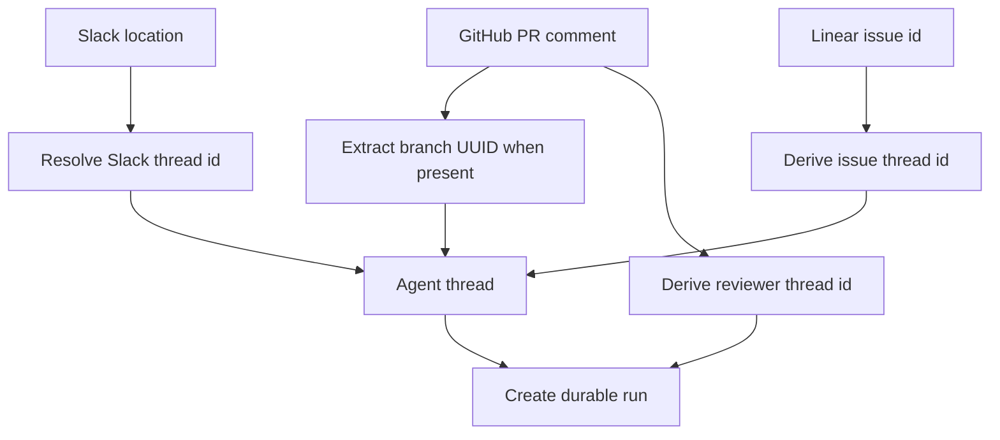
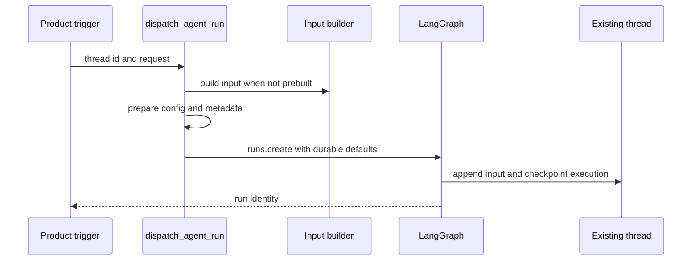

# Threads, Durable Runs, and State

A LangGraph thread is Open SWE's unit of continuity. A stable `thread_id` selects a conversation's checkpointed graph state and message history; thread metadata holds durable, queryable facts about that conversation; and the LangGraph Store holds separately namespaced application records. A run is an execution on that thread, not a replacement for it.

The boundary matters when changing an integration: a webhook, dashboard action, reviewer, or background task must route a follow-up to the right existing thread and supply a new input. It must not manufacture a random identity, overwrite another surface's source context, or replace a sandbox merely because a reconnect failed.

## Thread creation enforces a title

Threads are created through `openswe.threads.creation.create_thread`, which is the only place LangGraph threads are created. Every thread people can open must have a title; the module enforces this invariant by requiring a non-empty, stripped title string. Titles are stored in thread metadata and remain unchanging from the opening activity unless explicitly updated via the `title_locked` mechanism. System-named threads use `ensure_titled_thread` to create or keep titles current.

## Identity is a persistence contract

`openswe/thread_ids.py` is the single home for deterministic thread-id derivation. Its exact keys and namespaces are persisted routing contracts: separate processes re-derive IDs from external identifiers, so changing a formula makes existing threads unreachable through their normal entrypoints.

| Conversation or purpose | Derivation | Stable key |
| --- | --- | --- |
| Slack location | `slack_thread_id` | `slack:{channel}:{timestamp}:{nonce}` |
| PR comment on a non-Open-SWE branch | `pr_comment_thread_id` | `{owner}/{repo}/pr/{pr_number}` |
| Reviewer for a PR | `reviewer_thread_id` | `{owner}/{repo}/pr/{pr_number}/reviewer` |
| Repository review style | `review_style_thread_id` | `{owner}/{repo}/review-style` |
| Linear issue | `linear_issue_thread_id` | `linear-issue:{issue_id}` |
| GitHub issue | `github_issue_thread_id` | `github-issue:{issue_id}` |
| Baby-sit lock | `baby_sit_lock_thread_id` | `open-swe:baby-sit-lock:{key}` |

IDs are derived either as URL-namespace UUIDv5 values (Slack, PR-comment, reviewer, review-style, baby-sit lock) via `uuid.uuid5(NAMESPACE_URL, key)`, or as a SHA-256-derived UUID (Linear and GitHub issues) via `_sha256_uuid`. The reviewer key deliberately differs from the agent PR-comment key, so a PR's autonomous reviewer and its agent conversation cannot collide.

For a PR that Open SWE created, the GitHub PR-comment handler first extracts a UUID embedded in the branch with `thread_id_from_branch`; only a branch without one uses `pr_comment_thread_id`. Linear delivery uses `linear_issue_thread_id(issue_id)`, so redelivery stays on the issue's thread.


Thread identity lets independently triggered work converge on the correct durable conversation.

### Slack mappings support moves and retirement

Slack thread identity resolution and binding happen in `openswe/slack/records.py`. `resolve_slack_thread_id` first checks an explicit stored database mapping, then searches thread metadata for matching `source_context`, rejects multiple matches, and falls back to deriving a deterministic fallback ID or using an existing nonce. Binding validates the Slack location, refuses a conflicting existing mapping by raising, then verifies the write persisted; thus one Slack location cannot be assigned to two Open SWE threads.

Deleting associations does not simply erase the map: `delete_slack_thread_associations` writes a fresh nonce at that location. With no mapped ID, a future resolution derives a different fallback ID, avoiding collision with the retired conversation. This is used by moves such as creating a code channel.

A code channel is one session for the whole channel, keyed by `CODE_CHANNEL_SESSION_TS = "0"`, not a Slack reply thread. `manage_code_channel` rebinds the existing agent thread to `(channel_id, "0")` via `rebind_slack_thread` and updates its `source_context`. The sentinel selects `conversations.history` (fetching the whole channel with no thread-timestamp parameter); ordinary Slack conversations use `conversations.replies` keyed by thread timestamp. Slack's `processing`, `active`, `suspended`, and `closed` session statuses are Slack UI lifecycle state, distinct from LangGraph thread status.

## State ownership and metadata

Thread metadata is the durable cross-surface index and small per-thread state. `source_context` identifies the originating Slack location, Linear issue, GitHub issue, or PR; its Pydantic model permits unknown fields and preserves only supplied fields on output. It parses malformed historical metadata as an empty context rather than breaking a run. Upsert logic keeps the opening context rather than letting later activity repoint a thread, preserves the first title, and stores participant identities as metadata.

Participant logins and emails use key-per-person maps such as `{"octocat": true}`, rather than lists. That shape permits a JSONB containment query for one participant. Reviewer threads additionally carry `kind = "reviewer"`, plus reviewer-specific metadata such as PR state, head SHA, watch flag, and findings. The kind is both a UI/query discriminator and a completion-handling boundary: normal agent Slack completion work is skipped for reviewer threads.

Thread-level settings are a separate metadata snapshot under `agent_settings`. On the first run, model, effort, subagent model/effort, and repository instructions are chosen for the thread; sender identity, personal instructions, and PR preferences remain per-message. Later profile edits do not change the snapshot unless a caller explicitly stores a replacement, such as a model override. Reads cache for five minutes and reads/writes fail soft, so settings storage cannot prevent a run. Strict normalization drops invalid or obsolete settings rather than retaining arbitrary profile data.

The LangGraph Store in a LangGraph deployment holds separately namespaced application records distinct from thread metadata. Store access is typically through LangGraph SDK methods. Records in the Store follow similar patterns to thread metadata: malformed or missing records are handled gracefully to prevent cascading failures.

## RunConfig: the per-run configuration contract

`RunConfig` (`openswe/run_config.py`) is the per-run transport contract riding in every execution's `RunnableConfig.configurable` dictionary. It governs how independent writers (webhooks, dashboard, cron launchers, graph layers) coordinate without interfering:

**Three tolerant rules for forward compatibility:**
- **Unknown keys survive.** Writers add keys this module has never heard of (e.g., integrations adding per-run context), and call sites read a config, add to it, and pass it on. `extra="allow"` plus `RunConfig.dump()` (which excludes unset fields) keeps that round-trip byte-identical.
- **Parsing never raises, and never loses more than it has to.** Nothing validates `configurable` on write, so a single malformed value must not cost the run its `thread_id`. A field that fails validation is dropped iteratively; the rest is kept.
- **Everything is optional.** Which keys are present depends on the graph and the trigger; a reviewer run has no `agent_model_id` and a Slack run has no `pr_number`.

### RunConfig shape and examples

The dictionary typically carries:

**Identity and provenance:**
- `thread_id`: The LangGraph thread this run executes on
- `run_id`, `invocation_id` (aliased as `prepare_run_id`): Run and deduplication IDs
- `workspace`: Workspace slug for authorization and isolation
- `source`: Webhook trigger name (`"slack"`, `"linear"`, `"github"`, `"web"`, `"dashboard"`, `"automation"`, etc.)

**Actor and authorization:**
- `github_login`: GitHub user executing the run
- `github_user_id`: GitHub numeric ID for a system-started run
- `user_email`: Email of the person requesting the action
- `started_by_id`: API key or workflow name behind a system thread

**Repository context:**
- `repo`: A `Repo` object with `owner` and `name` fields
- `branch_name`: Code branch under review or being modified
- `pr_number`, `pr_url`, `pr_title`, `head_sha`, `base_sha`: Pull request details for reviewer runs

**Integration-specific context:**
- `slack_thread`: A `SlackThreadRef` with channel_id, thread_ts, triggering user, and channel metadata
- `linear_issue`: A `LinearIssueRef` with issue id and url
- `notion_page`: A `NotionPageRef` for Notion-triggered runs
- `github_issue`: A `GitHubIssueRef` for GitHub issue runs

**Model and effort selection (shadow thread-level settings):**
- `agent_model_id`, `agent_effort`: Override the thread's default agent model and reasoning effort
- `reviewer_model_id`, `reviewer_reasoning_effort`: Reviewer-specific model overrides
- `reviewer_subagent_model_id`, `reviewer_subagent_reasoning_effort`: Subagent model selection for reviewer runs
- `model_selection`, `model_selection_changed`: Track per-run model picker changes

**Behavior toggles:**
- `draft_prs`, `admin_thread`, `stop_summary`: Per-run flags
- `slack_ask`, `slack_breakout`, `slack_by_the_way_thread_ts`: Slack-specific modes
- `eval`, `reviewer_eval`: Mark a run as evaluation harness activity

**Repo/issue references (cross-repo):**
- `github_pr_or_issue`: A `GitHubPROrIssueRef` naming a PR or issue in a different repo than `repo`

### Agent vs. reviewer vs. scheduler shapes

```
Agent run (Slack or dashboard):
{
  "thread_id": "uuid...",
  "repo": {"owner": "octocat", "name": "Hello-World"},
  "source": "slack",
  "github_login": "octocat",
  "slack_thread": {
    "channel_id": "C123456",
    "thread_ts": "1234567890.000100",
    "triggering_user_id": "U123456",
    "triggering_user_name": "octocat"
  },
  "workspace": "default"
}

Reviewer run (PR review):
{
  "thread_id": "uuid...",
  "repo": {"owner": "octocat", "name": "Hello-World"},
  "pr_number": 42,
  "pr_title": "Add feature X",
  "head_sha": "abc123...",
  "reviewer_model_id": "claude-opus",
  "source": "github"
}

Scheduler/background run:
{
  "thread_id": "uuid...",
  "source": "schedule",
  "started_by_id": "schedule:nightly-check",
  "workspace": "default"
}
```

The `Repo` and `GitHubPROrIssueRef` models themselves permit unknown fields (`extra="allow"`), so custom per-repo metadata survives round-trips without loss.

## Follow-up input and run configuration

Each run supplies new messages; the graph retains its thread state. `build_run_input` serializes the authored request into an `<input-message>` envelope with a namespaced sender, surface, kind, optional channel, and structured data. It may precede that request with person, channel, and system `<dynamic-context>` introductions. Entity IDs are validated and text is escaped; Slack channel topic and purpose are marked untrusted.

Dynamic context blocks are content-hashed. `build_input_messages` excludes introductions already recorded in the injected-hash set. When summarization has moved early messages behind its cutoff, `visible_dynamic_context_hashes` treats those hidden blocks as no longer visible, allowing necessary identity context to be introduced again. This prevents deduplication state from making a summarized conversation lose information the model can no longer see.

## Durable dispatch and checkpoints

All product triggers use `dispatch_agent_run`, which delegates to `create_durable_run`; it can select the `agent` or `reviewer` graph and accepts either a prebuilt input or source identities, never both. The dispatch helper adds a unique `invocation_id` into both `configurable` and run metadata, merges supplied metadata, and enables the event-streaming marker.


A trigger creates a run on the selected durable thread using a normalized input and configuration.

### Durable defaults and checkpoint safety

The standard defaults are `multitask_strategy="interrupt"`, `durability="async"`, `if_not_exists="create"`, resumable streaming, the Protocol v3 stream modes, and subgraph streaming. Interrupt stops an active run while preserving its async checkpoint, then runs with history plus the follow-up; background work such as baby-sit can choose `enqueue`. Webhook triggers therefore do not need an in-process busy lock. A Store FIFO remains for deliberate dashboard injection and Slack message edits; it caps `pending_messages` at `MAX_QUEUED_MESSAGES` (100), dropping oldest entries.

**Async checkpoints** (`durability="async"`) write checkpoint state in the background while the next step runs, so a crash or pod recycle resumes from at most a step back instead of losing all work. Synchronous checkpoints (`"sync"`) made every step wait on its write (~0.3s per model/tool step in production); the durable default trades perfect durability for velocity.

**Stream resumability** (`stream_resumable=True`) retains the run's event stream so a client that attaches later (e.g., the dashboard observing a Slack-triggered run) can replay it. Without this the dashboard cannot observe a run it did not start: the v3 protocol only synthesizes the `lifecycle: running` event that drives `stream.isLoading` when it can replay the run's events, so a Slack/Linear/GitHub-triggered run looked idle in the web UI (no stop button) until it happened to emit its next event.

**Protocol v3 shape** sets `stream_mode` to include `values`, `updates`, `messages`, `custom`, `tasks`, and `checkpoints`, plus `stream_subgraphs=True` and the compatibility marker. The server fixes a run's streaming protocol at creation: without the marker a run streams `values` only, so the dashboard sees no `tools` events or subagent namespaces for externally triggered runs.

A completion webhook is attached only if `RUN_COMPLETE_WEBHOOK_SECRET` is set and `COMPLETION_WEBHOOK_URL` is an absolute non-loopback HTTP(S) URL. Otherwise dispatch logs a warning and creates the run without the webhook, rather than allowing a platform-rejected URL to fail every run. The checkpointer has deletion TTL configured as 43,200 minutes (30 days) with a 60-minute sweep interval: checkpointed state of inactive threads eventually expires.

### Invocation identity for deduplication and retry safety

Each run carries an `invocation_id` (aliased as `prepare_run_id` for backwards compatibility) in both metadata and configurable. This UUID is a deduplication key for follow-up messages and user retries: the same invocation_id on a follow-up to an existing thread means "reuse the same run result," while a new invocation_id always creates a fresh run. The ID is assigned once during dispatch and checked across metadata, configurable, and historical values to reject conflicts. A trigger should generate one invocation_id per user action, then reuse it on retries; this prevents duplicate work and user-facing duplicates when a webhook redelivers or a retry button is clicked.

## Task coordination and parallel work

The LangGraph Store and a dedicated `Task` model (`openswe/tasks/store.py`) coordinate threads doing parallel work under a single coordinator thread. This enables workflows where a orchestrating thread spawns worker threads to process parts of a job in parallel, then waits for them to complete.

**Task model:**
- `Task`: Represents a coordinating job with a `coordinator_thread_id`, optional `delegated` flag, workspace, and title.
- `TaskMembership`: Joins a thread to a task with a role (`"coordinator"` or `"worker"`).
- `TaskDelegation`: Records a worker's assignment with instructions, model, effort, and optional launch error.

**Workflow example: baby-sit watch joins a task**
1. A coordinator thread (e.g., an agent reviewing a PR) calls `Task.for_thread()` or explicitly creates a task.
2. A background worker thread (e.g., a baby-sit watch monitoring the PR for updates) calls `Task.reserve_worker()` passing the coordinator's thread id.
3. `reserve_worker` locks the coordinator, verifies it is indeed the coordinator of the task, and inserts a `TaskMembership` and `TaskDelegation` record for the worker.
4. The worker thread runs autonomously with instructions, model, and effort from the delegation.
5. If the coordinator dies or completes, the delegation records track what work was in flight, and garbage collection can clean up orphaned workers.

Parallel work in Open SWE uses this model to avoid duplicate instrumentation or centralized polling, letting each worker thread own its checkpoint and lifecycle.

## Thread metadata model and access control

Thread metadata stored in LangGraph carries:

**Lifecycle and visibility:**
- `title`: The thread's name shown in the sidebar (required, non-empty at creation).
- `source`: Where the thread originated (`"slack"`, `"github"`, `"linear"`, `"dashboard"`, etc.).
- `visibility`: `"public"` or `"private"` (defaults to public); private threads are readable only by owner or admins.
- `status` / `latest_run_status`: Thread busy/idle state and the last run's final status.
- `owner_login`: GitHub login of the thread creator or owner; immutable for private threads.
- `created_at`, `updated_at`: ISO timestamps; their millisecond versions are also stored for sorting.

**Integration anchors:**
- `source_context`: Embedded `SourceContext` dict with `slack_thread`, `linear_issue`, `github_issue`, or `pr_number`, depending on origin.
- `repo_owner`, `repo_name`, or nested `repo`: The repository associated with the thread.
- `sandbox_id`: The ID of the thread's Sandbox infrastructure backend (if any).

**Metadata for reviewer threads:**
- `kind = "reviewer"`: Marks the thread as a pull request review.
- `pr`: A dict with `number`, `title`, `owner`, `name`, `url` mirroring the PR identity.
- `pr_state`: Latest PR state (`"draft"`, `"open"`, `"merged"`, `"closed"`).
- `head_sha`, `base_sha`: Commit SHA values for the PR.
- `watched`, `watch_key`: Baby-sit watch metadata for monitoring the PR.
- Findings and review metadata for the review UI.

**Agent settings snapshot:**
- `agent_settings`: A frozen record of the model, effort, instructions, and subagent choices locked at the thread's first run.

**Participants:**
- `participant_logins`: A key-per-person map like `{"octocat": true, "another": true}` for JSONB query support.
- `participant_emails`: Similarly structured.

**Control flags:**
- `title_locked`: When true, system-generated title updates are skipped.
- `admin_thread`: Run requires admin privileges to message.
- `unlisted`: Thread is not listed in the sidebar (but remains accessible directly).
- `review_chat`: Private review-specific chat, readable only by its owner.

### Thread access checks

`openswe/threads/access.py` enforces authorization when fetching or acting on a thread:
- `_authorized_thread()`: Fetches and checks the caller may read it (raises HTTPException 404 if not).
- `_readable_thread()`: Fetch and authorize for unauthenticated callers or admins.
- `assert_thread_readable()`: Permit reading public threads and private threads owned by the caller or admins.
- `_assert_thread_promptable()`: Permit dashboard actions (prompting, plan edits, shell) only if readable and not bot-triggered.
- `_assert_thread_postable()`: Permit posting messages only if promptable and not awaiting a session upload, and only admins may message automation threads.

RunConfig carries workspace and user identity; the LangGraph metadata carries owner and visibility. Access checks combine them: a private thread is readable to its owner, workspace members with appropriate scope, and platform admins.

## Sandbox association and recovery boundary

A thread's `sandbox_id` in metadata connects durable conversation state to its working tree. `ensure_sandbox_for_thread` first uses a cached backend, otherwise reconnects using that ID, and creates a sandbox only when neither exists. It writes the ID only after creation and initialization have succeeded, then publishes the backend to the per-thread proxy cache. This ordering prevents the next run from adopting a half-built sandbox.

Do not interpret reconnect failure as permission to replace an agent sandbox. An unreachable existing sandbox raises `SandboxUnreachableError`: replacement could discard uncommitted work. A deleted sandbox (`SandboxGoneError`) is replaced because its stored ID otherwise bricks future runs. `allow_replacement` additionally permits replacement for an unreachable read-only reviewer sandbox whose checkout can be rebuilt. Explicit reset and recreate operations also bind a new ID only after the replacement has been prepared.

The proxy is a stable, thread-keyed backend handle. It serializes lazy reconnect startup and lets a middleware-held reference observe a newly connected backend, rather than handing each layer a stale backend object.

## Thread summary and listing

Thread summary (`openswe/threads/summary.py`) computes a display-ready summary of a thread's metadata, status, and recent activity for the sidebar and detail view. The summary combines:

- Derived title: The stored title, or for reviewer threads without a title, a default like `Review: #42 <PR title>`.
- Agent status: Combines thread `status` and the latest run's `run_status` to show `running`, `idle`, `finished`, `error`, or `interrupted`.
- Thread classification: Determines `category` (automation, pull_request, issue, interactive), `origin` (source), and `trigger_kind` (user, schedule, slack_bot, etc.).
- Visibility and access: Marks private threads, checks readability for the caller.
- Source URL: Slack permalink or Slack app redirect for code channels.
- Unread state: Tracks the latest run id and viewer's last view timestamp.

The summary engine also handles:
- **Dynamic context introduction:** Visible context blocks are recomputed after summarization to allow reintroduction of identity context.
- **Bot-triggered threads:** Threads started by Slack bots are read-only in the dashboard; steering happens in Slack.
- **Review walkthroughs:** Review-specific metadata (walkthrough progress, findings) is settled and displayed.
- **Automation threads:** System-started schedule or API threads are marked as automation and restricted to admin viewers.

## Thread wake budgets and background loops

A thread may start autonomous background runs between human messages (e.g., polls, monitoring, retries). To prevent runaway loops, `openswe/threads/wake_budget.py` tracks how many background wakeups a thread has spent since the last human message:

```python
THREAD_WAKEUPS = WakeBudget(
    generation_key="thread_wakeup_generation",
    count_key="thread_wakeup_count",
    limit=10  # Max 10 background runs per human message
)
```

The budget is stored in thread metadata and reset whenever a new human message arrives (detected by a generation key). If a thread exhausts its budget, `await THREAD_WAKEUPS.spend(client, thread_id)` returns False and the background job skips the wakeup. This prevents infinite loops of self-triggered activity.

Similarly, `MONITOR_WAKES` (limit 10) tracks runs started only to deliver sandbox monitor output, using separate generation and count keys.

## Operational checks

When changing these mechanisms, test the invariants rather than only a caller:

- Verify every new entrypoint chooses an existing deterministic ID or explicitly creates a new identity boundary.
- Exercise Slack mapping conflict, metadata fallback, duplicate metadata match, retirement nonce, and code-channel sentinel paths.
- Verify dispatch arguments, invalid completion-webhook degradation, interrupt versus enqueue behavior, and resumable Protocol v3 configuration.
- Verify input envelope escaping, identity validation, dynamic-context de-duplication, and reintroduction after summarization.
- Verify sandbox create/publish ordering and the distinction between unreachable and gone sandboxes. See [Sandbox Lifecycle](../architecture/sandbox-lifecycle.md).
- Verify RunConfig unknown-key preservation, parsing tolerance, and per-run metadata merging; test agent, reviewer, and scheduler shapes.
- Verify task coordinator locking, worker delegation, and membership cleanup.
- Verify thread access checks for public/private visibility, owner identity, and admin override.
- Verify wake budget reset on human messages and exhaustion preventing runaway loops.

For surrounding flows, see [Invocation](../workflows/invocation.md), [Follow-up Messages](../workflows/follow-up-messages.md), and [Models, Profiles, and Instructions](./models-profiles-instructions.md).
