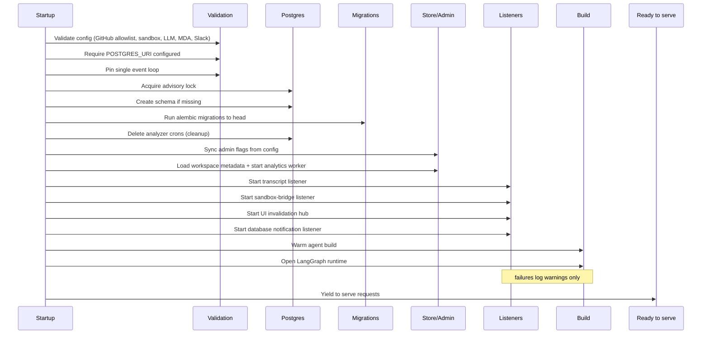

# Development, Deployment, and Serving

Open SWE is deployed as a single LangGraph application: three registered graphs (`agent`, `reviewer`, `review-scout`) plus a FastAPI application (`openswe.webapp:app`), wired through `langgraph.json`. PR chat and scheduled work run through FastAPI proxies and job-queue handlers rather than as separate registered graphs. The deployment topology determines serving: all components share one origin, so the LangGraph API (`/threads`, `/runs`, `/assistants`, `/store`), the FastAPI dashboard API (`/dashboard/api/*`), webhook endpoints (`/webhooks/*`), and the bundled dashboard UI are served from the same URL. Multiple replicas share Postgres for state and Redis for workers. The local development and production backend support Electron desktop clients as well as web clients.

See [Configuration](../operations/configuration.md) for the complete environment variable reference.

## Architecture

### Manifest and runtime versions

Open SWE's local development runtime uses Python 3.14 and LangGraph constraints `langgraph-api==0.18.0.dev13` and `langgraph-runtime-inmem==0.38.0.dev13` (set in `pyproject.toml` as constraint-dependencies). The manifest `langgraph.json` declares the Python version (`3.14`), LangGraph API version (`>~=0.15.0rc1`), the three registered graphs and FastAPI app (`http.app`), a checkpointer TTL policy (60-minute sweep interval, 43,200-minute—30 day—default TTL with delete strategy), and loads `.env` from the repository root.

For LangGraph Platform deployments, `langgraph.json` includes `dockerfile_lines` that perform a best-effort dashboard build: the platform extracts the `http.mount_prefix` from the manifest and supplies it to the build, then continues backend deployment even if the UI build fails. The standalone `Dockerfile` builds a production image using `langchain/langgraph-api:0.15.1-py3.14`, installs Open SWE with `uv`, and bakes graph registrations (via `LANGSERVE_GRAPHS`), the FastAPI app (via `LANGGRAPH_HTTP`), and checkpointer settings (via `LANGGRAPH_CHECKPOINTER`) into environment variables rather than manifest declarations.

### Startup sequence

The FastAPI lifespan handles the complete startup flow in a specific order, with certain failures logged but not blocking server readiness:



The FastAPI lifespan startup runs in this order:

1. **Configuration validation:** Validates GitHub login allowlist, sandbox provider startup config, Slack configuration, MDA client startup config, and local dev LLM config. Requires `POSTGRES_URI` to be set.
2. **Event loop:** Pins a single event loop before queue worker initialization to ensure workers land on the correct loop.
3. **Database setup:** Acquires an advisory lock (XID `557314367248862439`), creates the `open_swe` schema if it does not exist, and runs Alembic migrations to the latest revision using SQLAlchemy async connections.
4. **Cleanup:** Deletes legacy review-style analyzer crons that can no longer fire. Failures log warnings.
5. **Admin sync:** Admin flags are synced from `CONFIGURED_ADMINS` into the user table.
6. **Analytics activation:** Workspace records are loaded and reporting metadata is initialized; a pooled analytics event worker starts (reads the Store, writes to Postgres). Failures log warnings.
7. **Listeners:** Transcript, sandbox-bridge, UI invalidation, and database notification listeners start (handle multi-replica notifications). Failures log warnings.
8. **Build warming and ready:** The agent build is warmed for faster first use, then the LangGraph runtime opens all registered graphs. Failures log warnings.

Failures in any step except setup and migrations (steps 1–3) log warnings but do not prevent the server from running; the dashboard and API remain available, though affected features may degrade.

### Database migrations

Database migrations are Alembic-based and live in `openswe/database/migrations/versions/`. Each migration is a Python module implementing `upgrade()` and `downgrade()` functions.

**Migration lifecycle:**

- **Execution:** `openswe.database.migrate()` is called during lifespan startup and runs once (protected by an advisory lock to prevent concurrent migrations across replicas).
- **Schema:** Migrations run against the `open_swe` schema after the startup sequence creates it if missing.
- **Versioning:** Alembic tracks executed revision IDs in `open_swe.alembic_version`; upgrades run only new revisions.
- **Per-migration transactions:** Each migration runs in its own transaction, so partial failures roll back cleanly.
- **Preview environment:** On the `preview` environment (detected via `OPENSWE_ENV`), superseded revisions—those already stamped but now beneath another revision in the rebased chain—are deleted from the version table so the new chain applies cleanly.

**Recent migrations** include user management, workspace configuration, event tracking, automated workflow approvals, sandbox tooling, thread transcripts, skill storage, task coordination, event subscriptions, and review guide features.

### Checkpointer and state durability

Checkpointer configuration is declared in `langgraph.json` under the `checkpointer` key with TTL settings:

- **Strategy:** `delete` (async delete-based cleanup)
- **Sweep interval:** 60 minutes (cleanup runs every hour in the background)
- **Default TTL:** 43,200 minutes (30 days; checkpoints older than this are eligible for deletion)

**Durability guarantee:**

- Threads that restart within 60 minutes preserve their checkpoint state
- Beyond 60 minutes, checkpoints may be cleaned up asynchronously
- Multiple replicas share the same checkpoint storage (Postgres-backed), so a failed replica can resume threads on another replica as long as the database and Redis remain available

### Health checks and readiness

The backend exposes health check endpoints:

- **`GET /health`:** Returns `{"status": "healthy"}` immediately; always responsive
- **`POST /webhooks/run-complete`:** Token-verified webhook handler for run completion notifications

Neither endpoint performs database connectivity checks. A deployment using scale-to-zero hosting is unsupported because background runs rely on Redis and Postgres workers staying available between webhook deliveries.

## API and router configuration

The FastAPI app (created in `openswe/api/app.py`) applies CORS middleware to all routes with the following constraints:

- **Origins:** Parses `DASHBOARD_ALLOWED_ORIGINS` by splitting on commas and trimming whitespace
- **Credentials:** Sets `allow_credentials=True`, which forbids wildcard origins; the configuration explicitly rejects `*` in `DASHBOARD_ALLOWED_ORIGINS`
- **Allowed origins:** Adds all configured origins plus `open-swe://app` for the Electron client
- **Installed routers:** Dashboard API, plan, workflow approval, GitHub webhook, Slack webhook, Linear webhook, Notion webhook, health check, sandbox tool, and sandbox OpenAI routers

## Local serving modes

### Installation

Install backend dependencies:

```bash
make install
```

This runs `uv sync --extra dev` and installs Open SWE in development mode.

### Full development server

```bash
make dev
```

Executes `uv run langgraph dev --no-browser --port 2024 --n-jobs-per-worker 10`. The server runs all three graphs and the FastAPI app on `http://localhost:2024`, making both `/webhooks/*` and `/dashboard/api/*` endpoints available from a single process.

A local PostgreSQL 16 container (`open-swe-postgres`) is started automatically unless `POSTGRES_URI` is already set. The container binds to loopback only (`127.0.0.1:5433`) and persists data in a named volume (`open-swe-postgres`), so stopping the container preserves workspace and user data across restarts.

### FastAPI only

```bash
make run
```

Executes `uv run uvicorn openswe.webapp:app --reload --port 8000`. Serves only the FastAPI app (webhooks, dashboard API, bundled UI) without the LangGraph runtime. This is useful for HTTP-only development, but dashboard features that create LangGraph runs require `make dev`.

### UI development with hot reload

```bash
make dev-ui
```

Starts the dashboard Vite dev server on port 3000 and the LangGraph backend on port 2024 together with `-j2` parallelism. The backend receives `DASHBOARD_DEV_SERVER_URL=http://localhost:3000` and reverse-proxies non-reserved UI requests to it. Browser navigations stay on `http://localhost:2024` (the FastAPI origin), so API calls, login callbacks, and cookies work without cross-origin setup. The UI's HMR WebSocket connects directly to Vite's port.

### Web UI only

```bash
make web
```

Executes `pnpm run dev` (via root `package.json`'s Turbo task) to start the Vite dev server on `http://localhost:3000`. Proxies backend paths to `DASHBOARD_API_URL` (defaulting to `http://localhost:2024`) in the Vite config, so no `.env` file is needed. This requires `make dev` running on :2024 in another terminal.

### Dashboard build

```bash
make build-dashboard
```

Builds the dashboard from `ui/` into `ui/.output/public` with static assets and a `_shell.html` entry point. Optionally pass `DASHBOARD_BASE_PATH=<prefix>/` to build for a LangGraph `http.mount_prefix` (the `make dev` command reads it from `langgraph.json` automatically). The built dashboard is served by `make dev` at `/` and can be bundled into the Docker image or configured via `DASHBOARD_STATIC_DIR`.

### Electron desktop app

```bash
make desktop
```

Equivalent to `pnpm run dev:desktop`. Starts the Electron app in development mode, connecting by default to `http://localhost:2024` (the local dev backend). Use `--backend-url=<url>` or `OPEN_SWE_BACKEND_URL=<url>` to point at another deployment. The dev app uses an isolated `Open SWE Development` profile so it runs alongside an installed `Open SWE` app without sharing login, backend config, or projects.

## Webhook tunnel for development

```bash
make tunnel
```

Exposes the local development server on port 2024 through ngrok. Requires `NGROK_DOMAIN=<your-domain>.ngrok-free.dev` (claim a free static domain under **Domains** at https://dashboard.ngrok.com). Uses the policy file `examples/ngrok/webhooks-only.yml` to expose only `/webhooks/*` paths, protecting unauthenticated LangGraph development routes from public exposure.

```bash
make tunnel NGROK_DOMAIN=my-dev.ngrok-free.dev
```

Any other tunnel is acceptable as long as it enforces the same `/webhooks/*` allowlist (or a filtering proxy does).

## Dashboard integration with backend

### Bundled dashboard serving

The backend can serve a bundled dashboard build from `DASHBOARD_STATIC_DIR` (environment variable) or the in-repository `ui/.output/public` (when present after `make build-dashboard`). The dashboard UI is mounted at `/` and explicitly declines reserved API and LangGraph paths so its catch-all route does not shadow them:

- Reserved prefixes: `/dashboard/api`, `/webhooks`, `/health`, `/assistants`, `/threads`, `/runs`, `/store`, `/mcp`, `/a2a`, `/ui`, `/docs`, `/openapi.json`, `/info`, `/metrics`, `/ok`, `/assets`

**Asset caching:** Hashed assets are served with `Cache-Control: public, max-age=31536000, immutable`. The shell (`_shell.html`) is served with `no-cache` so new builds are picked up without forcing browser caches to refresh.

### Dashboard mount prefix

Dashboard asset and client-router paths must be built with `DASHBOARD_BASE_PATH` equal to a LangGraph `http.mount_prefix`. The platform manifest (`langgraph.json`) derives that build value from its `mount_prefix`, while local builds require it to be supplied:

```bash
make build-dashboard DASHBOARD_BASE_PATH=/dashboard/
```

The backend's manifest also declares `mount_prefix` (if present), so Vite respects it during development.

### UI development proxy

For UI development, `DASHBOARD_DEV_SERVER_URL` replaces the static build with a reverse proxy to the Vite dev server. The same origin hot-reloads without needing a build or cross-origin setup:

```bash
make dev-ui  # sets DASHBOARD_DEV_SERVER_URL=http://localhost:3000 internally
```

## Dashboard deployment topologies

### Bundled deployment (single origin)

The backend serves the compiled dashboard at `/` (when available). Browser API calls reach `/dashboard/api/*` on the same origin, so the session cookie (`osw_session`) stays same-origin and no cross-origin setup is needed. This is the default and recommended topology.

**Setup:**
1. Build the dashboard: `make build-dashboard`
2. Deploy the Docker image: it includes `DASHBOARD_STATIC_DIR=/opt/open-swe-dashboard` pointing to the platform manifest's bundled build, or deploy a prebuilt `ui/.output/public` with the backend.

### Separate dashboard deployment

Optionally, run the dashboard in a separate deployment (`ui/Dockerfile`) fronting a backend on a different origin. The dashboard container reads `DASHBOARD_API_URL` at runtime to determine which backend it fronts.

**Same-origin option:** If the dashboard reverse-proxies backend paths to the same origin, set `DASHBOARD_API_BASE_URL` on the backend to the dashboard origin and register it in `DASHBOARD_ALLOWED_ORIGINS`. The backend then fronts OAuth redirects manually, and the session cookie stays same-origin.

**Cross-origin option:** Alternatively, the browser calls the backend directly via `VITE_DASHBOARD_API_BASE_URL` (set at build time in the Vite config), and the backend must list the dashboard origin in `DASHBOARD_ALLOWED_ORIGINS`. This requires CORS and additional setup for OAuth redirects.

**Separate dashboard image:**
```bash
docker build -f ui/Dockerfile -t open-swe-dashboard .
docker run -e DASHBOARD_API_URL=https://backend.example.com -p 8080:8080 open-swe-dashboard
```

### LangGraph Platform deployment

The backend deploys to LangGraph Platform via a connected repository. The platform's `langgraph.json` manifest extracts `dockerfile_lines` to build and bundle the dashboard (set to `/opt/open-swe-dashboard`), then continues backend deployment if the UI build fails. The platform injects `LANGSMITH_API_KEY`, `LANGSMITH_TRACING`, and `LANGSMITH_PROJECT`, and you set the remaining environment variables.

**Deployment URL:** LangGraph Platform provides a URL like `https://<name>-<hash>.<region>.langgraph.app` for both the API and the UI (when bundled). Set `LANGGRAPH_URL` to this URL and webhook callback URLs to `<URL>/webhooks/*`.

## Docker image build

### Root Dockerfile (backend)

The standalone backend image builds from `langchain/langgraph-api:0.15.1-py3.14`:

1. Installs the Open SWE repository with `uv` into `/deps/open-swe`
2. Bakes graph registrations via `LANGSERVE_GRAPHS` (environment variable)
3. Bakes the FastAPI app via `LANGGRAPH_HTTP` (environment variable)
4. Bakes checkpointer TTL via `LANGGRAPH_CHECKPOINTER` (environment variable)
5. Cleans up pip/setuptools/uv to reduce image size
6. Exposes port 8000

The image does not build the dashboard itself; `dockerfile_lines` in `langgraph.json` (for platform builds) or a prebuilt `ui/.output/public` (for standalone) must provide it.

**Example standalone Docker deployment:**
```bash
docker build -t open-swe .
docker run \
  --env-file .env \
  -p 8123:8000 \
  -e DATABASE_URI="postgres://..." \
  -e REDIS_URI="redis://..." \
  -e LANGGRAPH_URL="https://backend.example.com" \
  open-swe
```

### ui/Dockerfile (dashboard)

Multi-stage Node 24 Alpine build (run from repo root):

1. **Build stage:** Installs frozen pnpm workspace, builds `open-swe-dashboard` into Nitro `.output` server
2. **Runtime stage:** Copies built output, runs as user `node` on port 8080

Reads `DASHBOARD_API_URL` at runtime (not build time), so one image serves any deployment.

**Example:**
```bash
docker build -f ui/Dockerfile -t open-swe-dashboard .
docker run -e DASHBOARD_API_URL=https://backend.example.com -p 8080:8080 open-swe-dashboard
```

### Platform build with dashboard bundling

The platform manifest (`langgraph.json`) declares `dockerfile_lines` that:

1. Install Node and pnpm
2. Copy workspace files and dashboard source
3. Extract `http.mount_prefix` and pass as `DASHBOARD_BASE_PATH` to the build
4. Build the dashboard with `pnpm --filter open-swe-dashboard run build`
5. Copy the build to `/opt/open-swe-dashboard`
6. Run `scripts/stamp_build_info.py` to bake source commit info into the bundle
7. Set `DASHBOARD_STATIC_DIR=/opt/open-swe-dashboard` for the backend

If the build fails, the log is captured but deployment continues; the backend then runs without the bundled UI.

## Standalone backend requirements

A standalone backend container requires:

**Agent Server dependencies:**
- `DATABASE_URI`: Postgres connection string (required, no default)
- `REDIS_URI`: Redis connection string (required, no default)
- `LANGSMITH_API_KEY`: LangSmith workspace API key (required for tracing and sandboxes)
- `LANGGRAPH_CLOUD_LICENSE_KEY`: LangGraph Cloud license (required)

**Application configuration:**
- `LANGGRAPH_URL`: Public backend URL (set to the deployment's hostname/domain)
- All variables from [Configuration](../operations/configuration.md)

**Do not use scale-to-zero hosting:** Background runs rely on Redis- and Postgres-backed workers staying available between webhook deliveries. Workers cannot spin up from nothing mid-run.

## Authentication and security

### LangGraph API authentication

The standalone image defaults to `LANGGRAPH_AUTH_TYPE=noop`, which leaves the LangGraph API (`/threads`, `/runs`, `/assistants`, `/store`) open to anyone who can reach the port. Only the dashboard API (session cookie) and webhooks (signatures) check anything themselves.

Set `LANGGRAPH_AUTH_TYPE=langsmith` to require a LangSmith API key from your workspace on every LangGraph call:

```bash
docker run \
  -e LANGGRAPH_AUTH_TYPE=langsmith \
  -e LANGSMITH_AUTH_ENDPOINT=https://api.smith.langchain.com \
  -e LANGSMITH_TENANT_ID=<workspace-id> \
  ...
```

This is what LangGraph Platform does by default and what Open SWE's own calls already send via `LANGSMITH_API_KEY`.

**Deployment security:** Use `noop` only on a private network behind a gateway that does the authentication for you. Raw LangGraph routes are not protected by dashboard sessions or webhook signatures.

### Dashboard session and CORS

The dashboard requires an `osw_session` cookie issued after GitHub login. GitHub login is controlled by `ALLOWED_GITHUB_ORGS` or `ALLOWED_GITHUB_USERS`. The GitHub App callback URL is `<URL>/dashboard/api/auth/callback`.

CORS is configured via `DASHBOARD_ALLOWED_ORIGINS` (comma-separated list). The backend explicitly rejects `*` (wildcard) because cookies require explicit origin allowlists. The Electron client is always allowed via `open-swe://app`.

## Multi-replica deployments

Multiple backend replicas share:

- **Postgres:** State, migrations, and analytics
- **Redis:** Job queue and workers
- **LangGraph Store:** Checkpointer state and shared data

**Cross-replica communication:**

1. **Transcript listener:** Reads Store writes from one replica, broadcasts to all
2. **Sandbox-bridge listener:** Long-polls for sandbox I/O requests, handles local bridge clients
3. **Analytics worker:** Reads the Store, writes analytics events to Postgres
4. **UI invalidation hub:** Broadcasts dashboard updates to connected browsers
5. **Database notification listener:** PostgreSQL NOTIFY/LISTEN for low-latency updates

Listener startup failures are logged as warnings; the replica continues with degraded feature support (e.g., transcript reads fall back to in-process notifications, dashboard updates poll instead of push).

## Desktop distribution and connection

The Electron app bundles the compiled dashboard UI and connects to a selected backend via `<backend-url>/dashboard/api/*`.

### Installation and packaging

**macOS installation:**
```bash
make install-desktop
```

- Verifies git, Node.js, Bun, and pnpm are available
- Refuses to run with a dirty working tree
- Fast-forwards to `main` and pulls from origin
- Runs `scripts/install_desktop.sh` to pack and install the app

**Packaged builds:** Ask for the organization's backend URL on first launch and store it in app user data. Use **Open SWE → Backend URL…** to switch deployments; switching clears the previous deployment's local session data.

### Local development

Development defaults to `http://localhost:2024`. Override with:

```bash
make desktop  # uses default localhost:2024
pnpm --dir desktop run start -- --backend-url=https://example.com  # override
OPEN_SWE_BACKEND_URL=https://example.com make desktop  # environment variable
```

Source launches use an isolated `Open SWE Development` profile so the dev app runs alongside an installed app without sharing login, backend config, projects, or single-instance lock.

### Desktop and "This Mac" threads

Desktop users can run agent work on their own machine via **This Mac** in the task composer. The thread is an ordinary cloud thread on the connected backend (same transcript, models, settings) whose sandbox is the project on this Mac instead of a hosted box.

**How it works:**
1. The app serves a local sandbox-bridge that long-polls the backend for `execute`, `upload_files`, and `download_files` requests
2. Requests run in the user's checkout with the login shell environment (minus secrets except `GITHUB_TOKEN` and `GH_TOKEN`)
3. Results are posted back to the backend

**Workspace selection:**
- **Current checkout:** Runs the agent in the project directory on the selected branch
- **New worktree:** Creates a git worktree on a `open-swe/local-<id>` branch; the agent renames it after reading the request. Multiple local threads can run without contending for a working tree.

**Lifecycle:** A thread runs only while the desktop app is open. Quitting closes the bridge, and the run reports the Mac as unreachable. Opening the thread again or sending a follow-up reopens it. Deleting a thread removes its worktree and any uncommitted changes.

### Security

The backend URL is public configuration, not a credential. Dashboard routes require an `osw_session` cookie issued after GitHub login. `ALLOWED_GITHUB_ORGS` or `ALLOWED_GITHUB_USERS` controls who may complete that login. CORS alone is not access control.

Raw LangGraph routes are a separate boundary. A deployment using `LANGGRAPH_AUTH_TYPE=noop` must keep those routes behind a private network, authenticated gateway, or custom LangGraph auth. An external user does not need the deployment's `LANGSMITH_API_KEY` to call an exposed, unauthenticated LangGraph route.

## Related operations scripts

### Sandbox snapshot creation

`scripts/create_sandbox_snapshot.py` builds a LangSmith sandbox snapshot from a Docker image using `SandboxClient` and prints the resulting UUID. Set the UUID as `DEFAULT_SANDBOX_SNAPSHOT_ID` in the deployment's environment.

### Purge wakeup crons

`scripts/purge_wakeup_crons.py` is a one-time backfill that deletes expired one-shot thread-wakeup crons from a deployment. Resolves the deployment URL from `--url`/`LANGGRAPH_URL` and the API key from `LANGGRAPH_API_KEY`/`LANGSMITH_API_KEY`.
