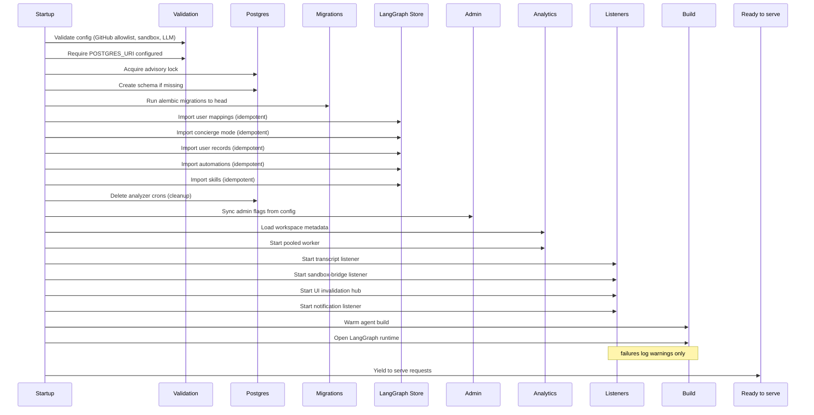

# Development, Deployment, and Serving

Open SWE is deployed as a single LangGraph application: three registered graphs (`agent`, `reviewer`, `review-scout`) plus a FastAPI application (`openswe.webapp:app`), wired through `langgraph.json`. PR chat and scheduled work run through FastAPI proxies and job-queue handlers rather than as separate registered graphs. The deployment topology determines serving: all components share one origin, so the LangGraph API (`/threads`, `/runs`, `/assistants`, `/store`), the FastAPI dashboard API (`/dashboard/api/*`), webhook endpoints (`/webhooks/*`), and the bundled dashboard UI are served from the same URL. Multiple replicas share Postgres for state and Redis for workers. The local development and production backend support Electron desktop clients as well as web clients.

See [Configuration](../operations/configuration.md) for the complete environment variable reference.

## Architecture

### Manifest and runtime versions

Open SWE's local development runtime uses Python 3.14 and LangGraph constraints `langgraph-api==0.19.0.dev3` and `langgraph-runtime-inmem==0.39.0.dev3` (set in `pyproject.toml` as constraint-dependencies). The manifest `langgraph.json` declares the Python version (`3.14`), LangGraph API version (`>~=0.15.0rc1`), the three registered graphs and FastAPI app (`http.app`), a checkpointer TTL policy (60-minute sweep interval, 43,200-minute—30 day—default TTL with delete strategy), and loads `.env` from the repository root.

For LangGraph Platform deployments, `langgraph.json` includes `dockerfile_lines` that perform a best-effort dashboard build using Node 26 and pnpm 11.22.0: the platform extracts the `http.mount_prefix` from the manifest and supplies it to the build, then continues backend deployment even if the UI build fails. The standalone `Dockerfile` builds a production image using `langchain/langgraph-api:0.16.9-py3.14`, installs Open SWE with `uv`, and bakes graph registrations (via `LANGSERVE_GRAPHS`), the FastAPI app (via `LANGGRAPH_HTTP`), and checkpointer settings (via `LANGGRAPH_CHECKPOINTER`) into environment variables rather than manifest declarations.

### Startup sequence

The FastAPI lifespan handles the complete startup flow in a specific order, with certain failures logged but not blocking server readiness:



The FastAPI lifespan startup runs in this order:

1. **Configuration validation:** Validates GitHub login allowlist, sandbox provider startup config, and local dev LLM config. Requires `POSTGRES_URI` to be set.
2. **Event loop:** Pins a single event loop before queue worker initialization to ensure workers land on the correct loop.
3. **Database setup:** Acquires an advisory lock (XID `557314367248862439`), creates the `open_swe` schema if it does not exist, and runs Alembic migrations to the latest revision using SQLAlchemy async connections.
4. **Store imports:** Migrates user mappings, concierge preferences, user records, automations, and skills from LangGraph Store to Postgres (each is idempotent, run once). Failures log warnings.
5. **Cleanup:** Deletes legacy review-style analyzer crons that can no longer fire. Failures log warnings.
6. **Admin sync:** Admin flags are synced from `CONFIGURED_ADMINS` into the user table.
7. **Analytics activation:** Workspace records are loaded and reporting metadata is initialized; a pooled analytics event worker starts (reads the Store, writes to Postgres). Failures log warnings.
8. **Listeners:** Transcript, sandbox-bridge, UI invalidation, and database notification listeners start (handle multi-replica notifications). Failures log warnings.
9. **Build warming and ready:** The agent build is warmed for faster first use, then the LangGraph runtime opens all registered graphs. Failures log warnings.

Failures in any step except setup and migrations (steps 1–3) log warnings but do not prevent the server from running; the dashboard and API remain available, though affected features may degrade.

### Database migrations

Database migrations are Alembic-based and live in `openswe/database/migrations/versions/`. Each migration is a Python module implementing `upgrade()` and `downgrade()` functions.

**Migration lifecycle:**

- **Execution:** `openswe.database.migrate()` is called during lifespan startup and runs once (protected by an advisory lock to prevent concurrent migrations across replicas).
- **Schema:** Migrations run against the `open_swe` schema after the startup sequence creates it if missing.
- **Versioning:** Alembic tracks executed revision IDs in `open_swe.alembic_version`; upgrades run only new revisions.
- **Per-migration transactions:** Each migration runs in its own transaction, so partial failures roll back cleanly.
- **Preview environment:** On the `preview` environment (detected via `OPENSWE_ENV`), superseded revisions—those already stamped but now beneath another revision in the rebased chain—are deleted from the version table so the new chain applies cleanly.

**Recent migrations** include user management, workspace configuration, event tracking, automated workflow approvals, sandbox tooling, thread transcripts, skill storage, task coordination, event subscriptions, and review guide features.

### Checkpointer and state durability

Checkpointer configuration is declared in `langgraph.json` under the `checkpointer` key with TTL settings:

- **Strategy:** `delete` (async delete-based cleanup)
- **Sweep interval:** 60 minutes (cleanup runs every hour in the background)
- **Default TTL:** 43,200 minutes (30 days; checkpoints older than this are eligible for deletion)

**Durability guarantee:**

- Threads that restart within 60 minutes preserve their checkpoint state
- Beyond 60 minutes, checkpoints may be cleaned up asynchronously
- Multiple replicas share the same checkpoint storage (Postgres-backed), so a failed replica can resume threads on another replica as long as the database and Redis remain available

### Health checks and readiness

The backend exposes health check endpoints:

- **`GET /health`:** Returns `{"status": "healthy"}` immediately; always responsive
- **`POST /webhooks/run-complete`:** Token-verified webhook handler for run completion notifications

Neither endpoint performs database connectivity checks. A deployment using scale-to-zero hosting is unsupported because background runs rely on Redis and Postgres workers staying available between webhook deliveries.

## API and router configuration

The FastAPI app (created in `openswe/api/app.py`) applies CORS middleware to all routes with the following constraints:

- **Origins:** Parses `DASHBOARD_ALLOWED_ORIGINS` by splitting on commas and trimming whitespace
- **Credentials:** Sets `allow_credentials=True`, which forbids wildcard origins; the configuration explicitly rejects `*` in `DASHBOARD_ALLOWED_ORIGINS`
- **Allowed origins:** Adds all configured origins plus `open-swe://app` for the Electron client
- **Installed routers:** Dashboard API, plan, workflow approval, GitHub webhook, Slack webhook, Linear webhook, Notion webhook, health check, sandbox tool, and sandbox OpenAI routers

## Local serving modes

### Installation

Install backend dependencies:

```bash
make install
```

This runs `uv sync --extra dev` and installs Open SWE in development mode.

### Full development server

```bash
make dev
```

Executes `uv run langgraph dev --no-browser --port 2024 --n-jobs-per-worker 10`. The server runs all three graphs and the FastAPI app on `http://localhost:2024`, making both `/webhooks/*` and `/dashboard/api/*` endpoints available from a single process.

A local PostgreSQL 16 container (`open-swe-postgres`) is started automatically unless `POSTGRES_URI` is already set. The container binds to loopback only (`127.0.0.1:5433`) and persists data in a named volume (`open-swe-postgres`), so stopping the container preserves workspace and user data across restarts.

### FastAPI only

```bash
make run
```

Executes `uv run uvicorn openswe.webapp:app --reload --port 8000`. Serves only the FastAPI app (webhooks, dashboard API, bundled UI) without the LangGraph runtime. This is useful for HTTP-only development, but dashboard features that create LangGraph runs require `make dev`.

### UI development with hot reload

```bash
make dev-ui
```

Starts the dashboard Vite dev server on port 3000 and the LangGraph backend on port 2024 together with `-j2` parallelism. The backend receives `DASHBOARD_DEV_SERVER_URL=http://localhost:3000` and reverse-proxies non-reserved UI requests to it. Browser navigations stay on `http://localhost:2024` (the FastAPI origin), so API calls, login callbacks, and cookies work without cross-origin setup. The UI's HMR WebSocket connects directly to Vite's port.

### Web UI development

```bash
make web
```

Executes `pnpm run dev`, which uses Turborepo to run the `dev` task for `open-swe-dashboard`. This starts the Vite dev server on `http://localhost:3000`. In development, the dashboard proxies backend paths to `DASHBOARD_API_URL` (defaulting to `http://localhost:2024`), so no separate `ui/.env` configuration is needed.

### Build the dashboard

```bash
make build-dashboard
```

Builds the dashboard into `ui/.output/public`, which `make dev` then serves at `/` if present. When deploying with a LangGraph `http.mount_prefix`, pass `DASHBOARD_BASE_PATH=<prefix>/` so the build's asset URLs and client router match where the server mounts it.

### Create a new migration

```bash
make migration m="migration description"
```

Creates a new Alembic migration file in `openswe/database/migrations/versions/`. The migration script is generated from the current schema and must be reviewed before running.

## Dashboard serving

The dashboard is a Vite-built single-page app served from `ui/.output/public`, containing a client-only `_shell.html` entry point and hashed static assets. The backend serves these through `openswe/utils/dashboard_ui.py`, which handles two serving modes:

### Bundled serving

The dashboard build is bundled into the backend (either in the repository as `ui/.output/public` or in `DASHBOARD_STATIC_DIR`). The backend serves it at `/` with:

- **`_shell.html`** with `Cache-Control: no-cache` so new deployments are picked up
- **Hashed assets** (e.g., `/assets/app-abc123.js`) with `Cache-Control: max-age=31536000,immutable`

Reserved API and LangGraph paths (`/dashboard/api`, `/webhooks`, `/threads`, `/runs`, `/store`, `/assistants`, etc.) are explicitly exempted from the catch-all, so the backend API is never shadowed.

### Development hot reload

When `DASHBOARD_DEV_SERVER_URL` is set, the backend reverse-proxies UI requests to the Vite dev server instead of serving the build. The browser stays on the FastAPI origin (`http://localhost:2024`), and the Vite HMR WebSocket connects directly to Vite's port.

## Dashboard proxying and cross-origin

In a separate dashboard deployment, the dashboard (`ui/server/backend-proxy.ts`) proxies browser `/dashboard/api/*` requests and webhook deliveries to the backend at `DASHBOARD_API_URL` (which throws if unset). The dashboard forwards the `osw_session` cookie on server renders, making requests same-origin when the dashboard origin is also the GitHub App callback URL.

Alternatively, the browser can reach the backend directly via `VITE_DASHBOARD_API_BASE_URL`, making requests cross-origin. This requires the dashboard origin in `DASHBOARD_ALLOWED_ORIGINS` and proper CORS setup.

## Tunneling for webhooks

```bash
make tunnel
```

Exposes local port 2024 through ngrok using a static domain (set `NGROK_DOMAIN=<name>.ngrok-free.dev`). The deployment runs an ngrok traffic policy that returns 404 for every path outside `/webhooks/*`, protecting unauthenticated LangGraph development routes from public exposure.

## Production deployment

### LangGraph Platform

Connect the repository to a new deployment in LangSmith → Deployments. The platform builds the image using `dockerfile_lines` in `langgraph.json`, which bundles the dashboard (with Node 26 and pnpm). The deployment URL serves the UI at `/` and the API beneath it; a failed UI build is logged and the backend still deploys. The platform injects `LANGSMITH_API_KEY`, `LANGSMITH_TRACING`, and `LANGSMITH_PROJECT`.

<!-- openwiki: broken internal link [../INSTALLATION.md] file "../INSTALLATION.md" does not exist. Fix the href or restore the target, then delete this comment. -->
Set the required environment variables (step 6 in [INSTALLATION.md](../INSTALLATION.md)):
- `GITHUB_APP_ID`, `GITHUB_APP_CLIENT_ID`, `GITHUB_APP_CLIENT_SECRET`, `GITHUB_APP_PRIVATE_KEY`
- `SLACK_BOT_TOKEN`, `SLACK_SIGNING_SECRET`, `SLACK_APP_ID`, `SLACK_BOT_USER_ID`, `SLACK_BOT_USERNAME`
- `ALLOWED_GITHUB_ORGS` or `ALLOWED_GITHUB_USERS`
- `CONFIGURED_ADMINS` (optional, for admin users)
- `LANGGRAPH_URL` (the deployment's public URL)

### Standalone Docker

```bash
docker build -t open-swe .
docker run \
  --env-file .env \
  -p 8123:8000 \
  -e DATABASE_URI="postgres://..." \
  -e REDIS_URI="redis://..." \
  -e LANGGRAPH_AUTH_TYPE="langsmith" \
  -e LANGGRAPH_URL="https://<your-backend-url>" \
  open-swe
```

The standalone image uses `langchain/langgraph-api:0.16.9-py3.14` and requires Agent Server backing services:
- `DATABASE_URI` (Postgres connection)
- `REDIS_URI` (Redis connection)
- `LANGSMITH_API_KEY` (LangSmith workspace API key)
- `LANGGRAPH_CLOUD_LICENSE_KEY` (LangGraph Cloud license)

Bundle the dashboard by running `make build-dashboard` before `docker build`, or set `DASHBOARD_STATIC_DIR` to a directory holding the build.

**Do not use scale-to-zero hosting:** Background runs rely on Redis and Postgres workers staying available between webhook deliveries.

#### Authentication modes

- **`noop` (default):** The LangGraph API is open; only the dashboard API (session cookie) and webhooks (signatures) check anything. Use only on a private network.
- **`langsmith`:** The LangGraph API requires a LangSmith API key on every call. Set `LANGSMITH_AUTH_ENDPOINT` and `LANGSMITH_TENANT_ID`.

### Dashboard-only Docker

The dashboard Dockerfile (`ui/Dockerfile`) is a multi-stage Node 26 Alpine build that creates a Nitro server:

```bash
docker build -f ui/Dockerfile -t open-swe-dashboard .
docker run \
  -p 8080:8080 \
  -e DASHBOARD_API_URL="https://<backend-url>" \
  open-swe-dashboard
```

The image reads the backend it fronts from `DASHBOARD_API_URL` at runtime, so one image serves any deployment. The dashboard proxies `/dashboard/api/*` and `/webhooks/*` requests to the backend.

## Electron desktop client

The desktop app is an experimental Electron client that connects to a shared backend. It downloads a standalone UI release selected by the connected backend and keeps the last complete UI on disk for offline use.

### How it connects

- **Local development:** By default, connects to `http://localhost:2024`; override with `--backend-url` or `OPEN_SWE_BACKEND_URL`
- **Packaged builds:** Ask for the backend URL on first launch and store it in local user data
- **Alternative environments:** When the backend sets `OPENSWE_ALTERNATIVE_ENVS="preview:https://...,staging:https://..."`, **Open SWE → Environment** switches between them (changes only until restart)
- **Desktop UI selection:** The backend `/desktop-ui.json` descriptor selects a GitHub Release archive by commit, SHA-256, and bridge protocol version
- **Proxy routes:** Electron proxies `/dashboard/api/*` requests to the selected backend, so the browser never receives LangSmith API keys or calls the raw LangGraph API directly

### Local development

Install dependencies and run the backend, then:

```bash
pnpm run dev:desktop
```

Or pass a custom backend:

```bash
OPEN_SWE_BACKEND_URL=https://... pnpm run dev:desktop
```

The dev flow uses an isolated 'Open SWE Development' profile so it can run alongside an installed app without sharing login, backend config, or projects.

### Installation on macOS

On Apple Silicon Macs running macOS Ventura or later:

```bash
brew install --cask langchain-ai/tap/open-swe-desktop
```

To build and install from source:

```bash
make install-desktop
```

This fast-forwards to the latest `main`, builds Open SWE, and installs it in `/Applications` (or `~/Applications` when needed). Run it again to update; saved backend settings, login sessions, and projects are preserved.

Update without changing git state:

```bash
make install-checkout
```

### Project workspaces and bridges

**This Mac projects:** Desktop users can run the agent over a selected local project. The thread is an ordinary cloud thread on the connected backend, but its sandbox is the project on the Mac instead of a hosted sandbox. The app serves it through a sandbox bridge that long-polls the backend for `execute`, `upload_files`, and `download_files` requests, runs them in the checkout, and posts results back. This is the same bridge that `oswe run` uses.

**Work mode:** New chats need no repository or folder selection. Open SWE creates a private task folder per conversation under `tasks/<thread-id>`. Multiple chats can select the same folder without sharing histories.

**Workspace selection:** **Current checkout** (the default) runs the agent in the project directory itself. **New worktree** gives the thread its own git worktree on a placeholder `open-swe/local-<id>` branch. Deleting a thread removes its worktree.

**Change tracking:** The **Changes** tab diffs the project against a git snapshot taken at session start, showing what the agent changed (not the working tree's prior state).

## Testing and validation

### Run tests

```bash
make test TEST_FILE=tests/
```

Runs pytest over the specified path. Use `make integration_tests` to run the integration test suite.

### Linting and formatting

```bash
make lint
make format
make format-check
```

- `lint`: Runs `ruff check` and formats checking via `ruff format --diff`
- `format`: Applies ruff formatting and fixes with `ruff check --fix`
- `format-check`: Checks formatting without applying changes

### Type checking

```bash
make typecheck
```

Runs `ty check` over `openswe`, `packages`, and `tests`, plus special Python 3.8 compatibility checks over sandbox scripts.

## Utilities

### Create a LangSmith sandbox snapshot

```bash
python scripts/create_sandbox_snapshot.py
```

Builds a LangSmith sandbox snapshot from a Docker image and prints the UUID to set as `DEFAULT_SANDBOX_SNAPSHOT_ID`.

### Purge expired wakeup crons

```bash
python scripts/purge_wakeup_crons.py
```

One-time backfill that deletes expired one-shot `thread_wakeup` crons. Resolves `LANGGRAPH_URL` from `--url` or the environment, and API key from `LANGGRAPH_API_KEY` or `LANGSMITH_API_KEY`.

### Install the CLI

```bash
make cli
```

Builds a single-file `oswe` binary using Bun (requires `bun` on the PATH). Compiles the CLI workspace and bundles it into a standalone executable that runs on any machine without Node or Bun installed.

## Multiple replicas and shared state

Multiple replicas share Postgres for state and Redis for workers. Cross-replica communication includes:

- **Transcript listener** (Store writes): Updates thread transcripts across replicas
- **Sandbox-bridge listener** (file I/O): Coordinates sandbox bridge requests
- **Analytics worker** (Store-to-Postgres): Persists analytics events
- **UI invalidation hub** (dashboard updates): Broadcasts dashboard cache invalidations
- **Database notification listener** (PostgreSQL NOTIFY): Delivers database events

Listener startup failures are logged as warnings and allow the replica to continue with degraded feature support (e.g., cross-replica notifications fall back to in-process mechanisms or liveness ticks).

## Makefile targets for operators

| Target | Purpose |
|--------|---------|
| `make install` | Install backend dependencies with dev extras |
| `make dev` | Run full LangGraph dev server on :2024 with local PostgreSQL |
| `make run` | Run FastAPI app only on :8000 |
| `make dev-ui` | Run UI dev server on :3000 and backend on :2024 together |
| `make web` | Run Vite dev server for dashboard on :3000 |
| `make build-dashboard` | Build dashboard into `ui/.output/public` |
| `make migration m="description"` | Create a new Alembic migration |
| `make test` | Run pytest tests |
| `make integration_tests` | Run integration tests |
| `make lint` | Lint Python code |
| `make format` | Format Python code |
| `make typecheck` | Type-check Python code |
| `make tunnel` | Expose local backend to webhooks via ngrok |
| `make install-desktop` | Install/update macOS desktop app from source |
| `make install-checkout` | Install desktop app from current checkout |
| `make cli` | Build standalone `oswe` CLI binary |
