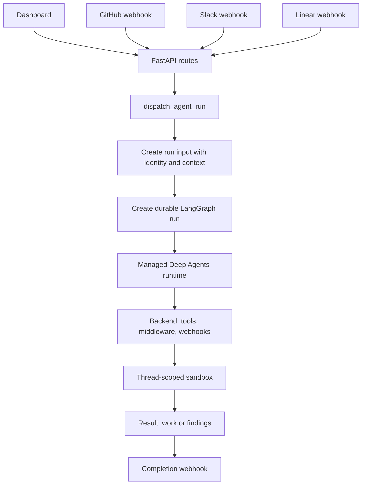

# Quick Start: Navigate the Open SWE Codebase

Open SWE is an asynchronous coding agent and software factory: work can arrive from the dashboard, GitHub, Slack, Linear, or a schedule; every agent, reviewer, and review-scout thread runs on Managed Deep Agents (MDA) where the model loop executes, while the backend runs tools, middleware, and webhooks. This page routes you through the wiki hierarchy based on your task. Read the relevant source and tests first; the linked OpenWiki pages are optional just-in-time context, not an authority over the repository.

## Start a local developer loop

Use Python 3.14 and `uv` for the backend. The dashboard and desktop workspace use `pnpm`.

```bash
make install            # uv sync --extra dev
make dev                # uv run langgraph dev --no-browser --port 2024
make dev-mda            # MDA runtime, separate terminal (default port 2025)
make run                # uv run uvicorn openswe.webapp:app --reload --port 8000
make dev-ui             # Vite plus LangGraph backend
make web                # pnpm run dev
make desktop            # pnpm run dev:desktop
```

**Typical flow:**

1. **`make dev-mda`** (in one terminal) — runs the Managed Deep Agents runtime on port 2025; required for any agent/reviewer/scout work.
2. **`make dev`** (in another) — runs `langgraph dev` serving all LangGraph graphs and the FastAPI app at port 2024.
3. **`make dev-ui`** (alternative to step 2) — runs Vite and LangGraph together so the dashboard hot-reloads without rebuilds.
4. **`make run`** — FastAPI-only (port 8000) for dashboard and webhook testing without graph changes or MDA.

Use `make dev` when a change needs LangGraph graph execution; it serves the HTTP app plus the read-only graph entrypoints registered in `langgraph.json`. `make run` is FastAPI-only for rapid dashboard and webhook testing without the graph runtime. For dashboard development, use `make dev-ui` to front Vite through the backend at `:2024` with hot reload; `make desktop` starts Electron and requires the backend separately. For local webhook exposure, use `make tunnel NGROK_DOMAIN=<name>.ngrok-free.dev` to restrict the ngrok policy to `/webhooks/*` only, since the development server has no authentication.

Python is async-first: implement the async path. Add a synchronous method only when an interface requires it, and make that method raise `NotImplementedError`; do not maintain parallel implementations.

## Entrypoints and execution boundaries

`langgraph.json` is the deployment registration point. It defines three read-only graph entrypoints (agent, reviewer, review-scout) that read threads from before Managed Deep Agents, plus the FastAPI HTTP app. Agent, reviewer, and scout runs execute their model loops on MDA via `openswe.threads.router`, which routes thread read/write requests to the MDA runtime URL. The backend runs all tools, middleware, and webhooks.

| Entrypoint | Mode | Owning module | Start here for changes to… |
| --- | --- | --- | --- |
| `openswe.graphs.agent:traced_agent` | Read-only (Managed Deep Agents runs via router) | `openswe/server.py` (agent factory) | Agent assembly, tools, skills, models, prompts, middleware, and coding sandbox preparation. |
| `openswe.graphs.reviewer:traced_reviewer_agent` | Read-only (Managed Deep Agents runs via router) | `openswe/reviewer.py` (reviewer factory) | Diff-grounded findings, review publication, reviewer sandbox behavior, and reviewer middleware. |
| `openswe.graphs.review_scout:traced_review_scout` | Read-only (Managed Deep Agents runs via router) | `openswe/review_scout/graph.py` (scout factory) | Diff walkthrough generation, commit ordering, and scout-specific sandbox behavior. |
| `openswe.webapp:app` | FastAPI app | `openswe/api/app.py` | Dashboard APIs/UI mount, health, plan/approval APIs, CORS, and webhook ingress. |

### Request flow: from trigger to durable run

All interactive triggers (dashboard, GitHub, Slack, Linear webhooks) and background work converge through a single dispatch contract. The key entrypoint is `openswe.dispatch:dispatch_agent_run`, which creates a durable LangGraph run with the appropriate graph (agent or reviewer) using a configurable multitask strategy (default: `interrupt`). The run executes on Managed Deep Agents; the backend answers the agent's tool calls and routes plan/execute phases through `/agent-api/{endpoint}`.



Each agent/reviewer/scout run owns one thread on Managed Deep Agents; the backend never runs the model loop directly. The graph modules (`openswe/graphs/`) are thin read-only re-exports that serve thread history; the actual agents are built by their factory modules (`openswe/server.py`, `openswe/reviewer.py`, `openswe/review_scout/graph.py`).

### Key invariants to preserve

- **Managed Deep Agents runtime required:** Every agent, reviewer, and scout thread runs on MDA. The backend refuses to start without `MDA_RUNTIME_URL` and `MDA_RUNTIME_TOKEN_SECRET`.
- **Backend thread router:** `openswe/threads/router.py` serves the LangGraph Agent Server's thread API from the PostgreSQL thread index and routes runs there. Threads created before MDA are read-only via `openswe/graphs/read_only.py`.
- **Durable dispatch contract:** `dispatch_agent_run` is the shared creation contract for all Slack, Linear, GitHub, and dashboard triggers. Its default multitask strategy is `interrupt` (follow-ups interrupt and resume with full history), and callers must choose exactly one input-construction path: either a prebuilt run input or separate content/context/identity parameters—not both.
- **Tool calls on backend:** MDA makes the model loop calls; the backend runs every tool invocation. Behavior reaches MDA without changes there: middleware adds to each model call only through `ashape_model_call` (shapes the system prompt and tool set for a single call), and the backend wraps responses with `awrap_model_call` for tracing.
- **Sandbox preservation:** Only the reviewer and scout opt into sandbox replacement because their checkouts are recreated each run. Do not silently replace an unreachable main-agent sandbox—it could contain uncommitted work.
- **Reviewer constraints:** The reviewer has no commit, push, or PR-opening tools; it only adds findings.
- **FastAPI startup:** The lifespan pins a single event loop before queue construction, validates sandbox and local-development LLM configuration at startup, and configures credentialed CORS for configured dashboard origins only—rejecting a wildcard origin.

## Choose the detailed guide

### Architecture and extensibility

- [Runtime and Product Architecture](architecture/overview.md) — LangGraph deployment structure, Managed Deep Agents integration, FastAPI composition, durable dispatch, and surface boundaries.
- [Coding Agent Assembly](architecture/agent-graph.md) — agent factory, backend/model/profile resolution, curated tools, skills, subagents, and sandbox preparation.
- [Middleware and Failure Boundaries](architecture/middleware-stack.md) — ordering-sensitive retries, timeouts, guards, queues, fallbacks, error reporting, and model shaping.
- [Thread Sandbox Lifecycle](architecture/sandbox-lifecycle.md) and [Sandbox Provider Integration](integrations/sandbox-providers.md) — thread binding, safe recovery, provider selection, and adding a provider.
- [Review and Style Analysis Graphs](architecture/reviewer-and-analyzer.md) — the non-mutating reviewer and review-scout, finding lifecycle, and diff walkthrough.
- [Threads, Durable Runs, and State](concepts/threads-and-state.md) — checkpoints, metadata, thread identity, MDA vs. local-runtime distinction, and ownership boundaries.
- [Tool Catalog and Authorization](concepts/tools.md) — exporting, wiring, authorizing, and safely changing tools.
- [Models, Profiles, and Instructions](concepts/models-profiles-instructions.md) — configuration precedence, model routing, and prompt inputs.

### Ingress, product, and delivery workflows

- [Inbound Invocation to Durable Run](workflows/invocation.md) — validation, identity/context construction, threads, dispatch, and completion across dashboard, desktop, Slack, Linear, GitHub, and automation.
- [Pull Request Review Workflow](workflows/pr-review.md) — manual/automatic reviews, findings, publishing, replies, and settlement.
- [Scheduling, Background Work, and CI Monitoring](workflows/scheduling-and-baby-sit.md) — schedule lifecycle, reconciliation, watches, and background tasks.
- [Dashboard and Desktop Clients](integrations/dashboard-ui.md) — authenticated browser APIs, UI proxy/mount behavior, Electron supervision, and local projects.
- [Authentication, Authorization, and Secret Boundaries](concepts/auth-and-security.md) — webhook verification, membership gates, OAuth/App tokens, encryption, and credential proxies.
- [Observability, Browser, and MCP Integrations](integrations/observability-and-mcp.md) — optional integrations and their configuration/authorization gates.

### Operations

- [Configuration and Startup Validation](operations/configuration.md) — lazy environment settings, persisted administrator settings, credentials, aliases, and failure behavior.
- [Development, Deployment, and Serving](operations/deployment.md) — local versus deployed serving, dashboard builds/mount prefixes, webhook exposure, desktop distribution, and MDA integration.

### Testing

- [Testing Strategy and Patterns](testing/overview.md) — test ownership, shared fixtures, deterministic patterns, and focused E2E validation.

## Validate only the changed boundary

**Never run the full suite locally.** Select the narrowest test that owns the behavior, then run the relevant quality check.

```bash
make test TEST_FILE=tests/github/test_open_pull_request.py
uv run pytest -vvv tests/path/to_test.py::test_name
make lint
make format-check
make typecheck
```

`make test` accepts an existing path; use direct `pytest` for a node id. Pytest uses asyncio auto mode; shared fixtures substitute an in-memory store through the production serialization route, clear the global TTL cache before and after each case, hide any locally bundled dashboard, and enable auto-review by default. Override those defaults explicitly when testing their gates.

Use focused pytest families such as `tests/agent/`, `tests/reviewer/`, `tests/sandbox/`, `tests/webhooks/`, `tests/dashboard/`, `tests/github/`, `tests/slack/`, `tests/middleware/`, or `tests/tools/` according to the changed owner. Run a focused dashboard or desktop workspace check through its package when changing frontend code.

### End-to-end validation

Escalate to a Playwright spec only for a genuine cross-boundary contract. The E2E harness exercises real agent code, a temporary local sandbox, local git, the real dashboard, and Electron paths while faking the LLM and external SaaS HTTP boundaries. See [Testing Strategy and Patterns](testing/overview.md) and [E2E Testing Setup](repo://tests/e2e/README.md) for test ownership, fakes, happy-path flows, and run commands.

```bash
pnpm install --frozen-lockfile
pnpm run test:e2e:install
pnpm exec playwright test tests/full_flow.spec.ts
```
