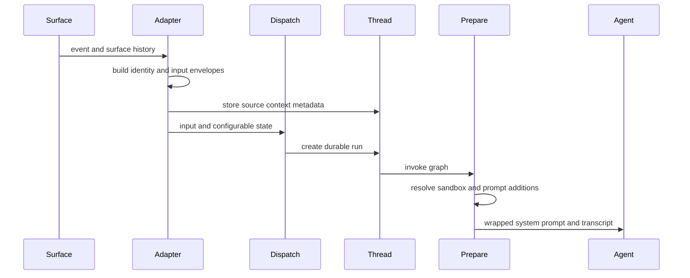

# Context and Prompt Engineering

Context is assembled in layers rather than by passing an event body verbatim to a model. Surface adapters construct a normalized `RunInput` transcript and run configuration; `dispatch_agent_run` enforces the durable-run boundary and rejects ambiguous calls that combine a prebuilt input with raw content or identities. At execution time, prepare middleware resolves fresh, run-specific prompt material, checkpoints it by fingerprint, and supplies a wrapped system message to the agent. For reviews, the middleware also pre-materializes the repository and diff before any model inference.

This shows the separation between event normalization at dispatch and run-specific prompt preparation at execution. [Invocation](invocation.md) covers durable execution and [Follow-up messages](follow-up-messages.md) covers subsequent thread turns.

## Normalized input transcript

`input_messages.py` is the serialization boundary for application-owned input. A human or system message is represented as an `<input-message>` envelope with a namespaced sender, surface, kind, optional channel, structured `<data>`, and escaped content. It supports multimodal block lists by enveloping text blocks while preserving non-text blocks. Entity introductions appear first as `<dynamic-context>` XML messages for people, channels, and systems. Slack channel `topic` and `purpose` fields are contextual metadata, not trusted instructions, and belong in the channel identity alongside name and thread reference, not in the system prompt.

The generic dispatcher derives identities when an adapter has not supplied a complete input: Slack uses the triggering-user and channel information in `RunConfig`; GitHub login or Linear email supplies a person identity; otherwise the event is attributed to a synthetic system identity. Adapters can instead pass a deliberately ordered prebuilt transcript, which is necessary when history contains several participants or system/bot messages.

`dispatch_agent_run` validates its inputs strictly: if a prebuilt `input` is provided along with any of the raw fields (`content`, `context`, `channels`, `systems`), it raises a `ValueError`. This enforces that callers choose one path: either construct the input themselves and pass it directly, or pass raw content and identities and let the dispatcher construct it. Once validated, the run is created using the v3 streaming protocol with async durability, resumable event streams, and an optional completion webhook.

### Surface-specific history

- **Slack** builds a channel introduction, then serializes prior thread messages in order with each human, Open SWE, and third-party bot attributed separately. It adds an operational system-context message and appends the triggering request as a human message. The trigger-user fallback prevents edits and button interactions from being attributed to the bot or to nobody.
- **Linear** makes the issue description a system message with issue metadata, then appends relevant comments as human messages with per-author introductions and comment IDs. It uses comments from the triggering comment onward when available; otherwise it uses recent comments while filtering known bot responses. Images from the description and included comments remain multimodal blocks.
- **GitHub** creates attributed messages carrying issue/PR, comment type, path, line, and time metadata. A new issue thread fetches its comments to construct initial context, while an existing issue thread sends only the new follow-up/update. PR-comment runs similarly pass the comment sequence as structured input.

### Dynamic context across turns

An introduction uses XML serialization of the entity definition. `build_input_messages` suppresses identities already supplied to that construction, while thread metadata records injected hashes via `injected_dynamic_context_hashes`. The visible-message check accounts for deepagents summarization: only contexts at or after the summarization cutoff count as visible, allowing a forgotten identity to be introduced again. Parsing helpers also validate sender/entity identifiers and safely ignore malformed XML rather than treating it as authoritative context.

## Provenance is persistent metadata, not the transcript

`SourceContext` records the durable routing origin: a Slack thread, Linear issue, GitHub issue, and/or PR number. Webhook/adapters upsert it under `source_context` in LangGraph thread metadata; the first nonempty origin is preserved when later messages arrive, and the same record is carried by baby-sit watches. This is a pointer used for communication and lifecycle behavior, whereas the normalized `RunInput` carries what the model should see now.

The type is intentionally tolerant of distributed writers. All context models allow unknown fields and `dump()` uses `exclude_unset=True`, preserving unrecognized data through a read-enrich-write cycle instead of inventing defaults. `parse()` accepts only mappings and returns an empty context—with a warning on validation failure—rather than failing a run on malformed historical metadata.

## Prepare middleware: checkpoint and lazy resolution

Prepare middleware runs once per invocation before the agent's first model call. It performs sandbox and environment setup, resolves credentials and workspace config, and renders the system prompt with all layer material. The main agent and reviewer use separate subclasses that share idempotence logic.

### Idempotence and fingerprinting

`BasePrepareRunMiddleware` checkpoints idempotent setup by computing a SHA256 fingerprint of the middleware class name, the latest message's content/id/type, and run-specific config fingerprint (repo, invocation ID, model choices, etc.). Once its before-agent update is checkpointed under `run_prepared_for`, a resumed attempt with the same fingerprint skips preparation; a later invocation prepares fresh credentials, prompt, and context. Preparation must therefore be idempotent, and a sandbox failure is surfaced and re-raised rather than silently continuing without a workspace.

For every model call, the middleware combines the rendered prompt with any existing system message using `awrap_model_call`. The main prompt states that repository custom instructions and workspace instructions are mandatory, while `AGENTS.md` overrides them on conflict; sender-level standing instructions yield to repository instructions and `AGENTS.md`.

### Main-agent preparation (PrepareAgentRunMiddleware)

`PrepareAgentRunMiddleware` executes in `_prepare` and produces several key outputs:

- **Sandbox resolution**: determines the sandbox backend and resolves the `work_dir`, the per-run checkout directory passed to all filesystem/shell tools
- **Environment and identity**: fetches GitHub token, resolves the triggering user's GitHub identity, loads workspace settings, and computes model-selection routing
- **Participant context**: fetches the thread's participant list filtered by deduplication rules; constructs separate sender-context messages (not spliced into cached history) with identity, workspace-admin status, git configuration, and user-level instructions
- **Rendered system prompt**: calls `construct_system_prompt` with all context variables: repo info, task title, user instructions, workspace settings, tool descriptions, effort level, and any repository-specific preferences
- **Recent thread context**: optionally includes a digest of the sender's recent threads for orientation (audience-filtered by Slack channel and workspace)

Return state includes `rendered_system_prompt` (merged into the agent's system message by `awrap_model_call`), `work_dir`, sender-context messages, model/effort selection, and metadata updates.

### Reviewer preparation (PrepareReviewerRunMiddleware)

Reviewer preparation is deterministic and parallelized. It fetches the PR diff, computes the diff line-set used for finding anchor validation, checks out the repository at the PR head, and materializes trusted skills from the base revision.

**Diff acquisition and validation:**
- `fetch_pr_diff` retrieves the unified diff from GitHub REST API using the base..head range, the same diff used for inline review comment validation
- `compute_diff_line_set` parses the diff and builds a `{file: {"RIGHT": {new_lines}, "LEFT": {old_lines}}}` mapping used by `add_finding` and `publish_review` to validate that findings anchor to lines actually in the diff

**Repository checkout:**
- Reviewer cannot assume a sandbox clone exists; instead uses `prepare_review_repo` to clone-or-fetch the repo (with blob-less `--filter=blob:none` to reduce size) and check out the PR head via `git checkout --force`
- Checkout includes fetching base SHA and PR head SHA concurrently to cover both same-repo and fork PRs, with strict verification that `HEAD` matches the intended SHA
- Returns `True` only if the repo is prepped and checked out; `False` leaves sandbox usable (review works off the fetched diff)

**Trusted skills:**
- Prevents PR authors from injecting instructions into the reviewer prompt by materializing SKILL.md files from the PR base revision (not the PR head, which the author controls)
- `materialize_trusted_skills` extracts skill directories (`.agents/skills` or `.claude/skills`) via `git archive` at the trusted base SHA into a separate `.review-skills` directory outside the checkout
- Mounts extracted paths for routing to `SkillsMiddleware`; individual extraction failures do not prevent skill wiring or the review

## Prompt preparation and instruction ordering

The graph factory creates a deep agent with an initially empty system prompt. `BasePrepareRunMiddleware` and its subclasses perform setup before the agent is first called.

### Instruction precedence in the main agent

The complete instruction hierarchy in `construct_system_prompt`, from lowest to highest precedence, is:

1. **Default system guidance** — working environment, tools, task execution, dependencies, commit/PR, and self-awareness sections.
2. **Environment instructions** — workspace custom instructions configured by an admin.
3. **User instructions** — standing instructions for the triggering sender, stored per GitHub login. The prompt notes that these yield to repository and `AGENTS.md` instructions.
4. **Repository custom instructions** — configured by a workspace admin for this repository. The prompt treats them as mandatory rules and states they override defaults, but lose to `AGENTS.md` on conflict.
5. **`AGENTS.md` at the repository root** — mandatory rules that override all prior instruction sources.
6. **Scoped `AGENTS.md` files** — injected by `SubdirAgentsReadMiddleware` after successful `read_file` calls, with deeper scopes taking precedence.

## Repository conventions: AGENTS.md and CLAUDE.md

### Main agent (hosted runs)

The main-agent prompt requires that, after a repository is synchronized or cloned, the agent read the root `AGENTS.md` in full before other work. Its rules override defaults. `SubdirAgentsReadMiddleware` supplies a second, scoped mechanism: after a successful string-result `read_file`, it reads ancestor `AGENTS.md` files from the run sandbox and appends a `<system-reminder>`. Candidates are shallowest to deepest, and the reminder states that deeper scope wins. It tracks loaded paths per thread, treats a direct `AGENTS.md` read as loaded, limits reads to 1,000 lines and 64 KiB (with truncation), and lets a missing, unreadable, non-UTF-8, or otherwise unusable candidate fail without breaking the requested read.

### Reviewer (code review)

The reviewer cannot assume a sandbox clone; instead, it fetches convention documents deterministically from GitHub at the PR base SHA (never the PR head, which the author controls). It prefers `AGENTS.md` and falls back to `CLAUDE.md` only when a 404 indicates the preferred file does not exist. A non-200 response, network failure, or content exceeding 64 KiB produces no root context rather than stale fallback rules, ensuring the reviewer enforces only documented conventions.

The reviewer also derives ancestor convention paths for changed files and fetches scoped files concurrently via `fetch_scoped_agents_md`, which uses `git ls-tree` and `git cat-file` to read files efficiently from the trusted base revision. Up to 8 concurrent requests are possible, but each candidate independently skips failures (missing, oversized, unreadable, or non-UTF-8 files); the absence of one scoped file does not hide valid instructions in another changed subtree. The ordered results make nested instructions override parent instructions.

Fetching `AGENTS.md` and scoped variants happens in parallel with repo checkout and diff computation during `PrepareReviewerRunMiddleware`. This deterministic loading means the reviewer assesses a pull request against rules that were stable at the PR base, not rules introduced or modified by the PR itself.

## Approval policy selection by review type

The reviewer's approval behavior—whether it only comments (`dry_run`), never approves (`off`), or submits GitHub approvals (`approve`)—is selected per repository from the review style record, persisted in LangGraph Store at the `review_styles` namespace. When a reviewer runs, `approval_policy_for_review` checks the approval mode first; if the mode is `off`, no policy is fetched. Otherwise, it fetches `.open-swe/APPROVALS.md` from the default branch (not the PR head), ensuring the PR cannot rewrite the criteria it is judged by. A failed lookup or non-200 response returns `None` and the review proceeds without a custom policy; the mode applies to all PRs in the repository and is configured in the dashboard.

## Skills: lazily readable prompt extensions

Skills are instructions exposed as virtual `SKILL.md` files rather than copied wholesale into the prompt. A `CompositeBackend` keeps the run backend as default and routes skill prefixes to specialized backends; it strips the route prefix before delegation. Passing those prefixes in `create_deep_agent(skills=[...])` lets deepagents advertise skills while the agent reads full instructions through ordinary `read_file`.

The main graph always mounts repository-bundled `baby-sit` and `html-artifacts` skills read-only at `/bundled-skills/`. Hosted runs additionally mount organization skills read-only at `/organization-skills/` and, when a profile login exists, per-user skills read-only at `/skills/`; the user route is first in the sources list, so it has priority in lookups. Skills are persisted as `/<name>/SKILL.md` under the appropriate store namespace with YAML name/description front matter and a replacement instruction body. Names, sizes, and organization count are bounded; user tools resolve the current GitHub login, while organization-skill tools require an admin. Desktop runs instead source user skills from run state, omit organization skills, and route artifacts away from the project checkout.

### Reviewer: trusted skills from base revision

The reviewer materializes trusted skills from the PR base revision via `materialize_trusted_skills` into a separate `.review-skills` directory outside the checkout. This prevents a PR author from injecting instructions into the reviewer prompt by adding or editing a `SKILL.md`. Skills are sourced from `.agents/skills` or `.claude/skills` relative to the repository root, extracted via `git archive` at the trusted base SHA. The extracted paths are then routed to `SkillsMiddleware` for mounting. If extraction fails for a skill directory, the reviewer continues without it; a single missing directory does not prevent skill wiring or the review.

## Sender context and participation

The main agent includes sender context as separate structured messages produced by `PrepareAgentRunMiddleware`, not spliced into cached history. After resolving the sandbox and environment, the middleware fetches the current thread's participant list, constructs `PersonIdentity` blocks for each, and filters out any whose dynamic-context hash is already visible in the message history. This preserves the immutability of cached history while introducing or reintroducing participation metadata when the model needs it.

Sender context includes identity, workspace-admin status, git configuration, collaboration metadata, and user-level instructions. The middleware identifies the latest human message and uses that sender's identity as the subject for participant context; if no human message exists or the sender cannot be determined, participant blocks are omitted from that invocation.

## Recent thread context

The agent's prompt can include a digest of the sender's recent threads for orientation. `recent_thread_context_section` fetches a sender's recent threads filtered by audience rules: `"private"` includes only the sender's own public and privately-owned threads, while `"shared_slack"` further filters to threads in the same Slack workspace and channel. The digest is bounded: up to 5 threads, each title capped at 160 characters, total payload capped at 4,000 characters. The selector enforces a 1-second timeout and scans at most 100 threads to find eligible ones, dropping older entries when the payload exceeds limits. This context is background information, not instructions, and is selected under audience rules that keep private-workspace metadata from leaking into shared conversations.

## Review style and organization guidelines

Reviewer prompts can include optional organization guidelines and a custom repository style prompt, both fetched during `PrepareReviewerRunMiddleware`. These are fail-soft: a store outage or network failure during fetch causes the reviewer to omit that supplement without failing the review. Organization guidelines are cached across review runs in the same workspace. The custom repository style prompt is editor-curated per-repository and supplements the default review guidance with specific technical standards or preferences.

## Safe change and focused verification

Changes to this workflow should preserve the boundary between untrusted event content, structured identity metadata, durable provenance, and system instructions. In particular, do not turn channel fields into trusted prompt text, mutate cached historical messages to add current sender data, or suppress a dynamic context merely because it exists before the summarization cutoff.

Focused tests live in `tests/agent/test_input_messages.py`, `tests/agent/test_source_context.py`, `tests/agent/test_dispatch.py`, `tests/agent/test_agents_md.py`, `tests/middleware/test_subdir_agents_middleware.py`, `tests/slack/test_slack_context.py`, `tests/agent/test_skills.py`, `tests/middleware/test_prepare_run_middleware.py`, and `tests/threads/test_recent_context.py`. They are the first checks for envelope/hashing behavior, malformed provenance, dispatch contracts, convention-document failure modes, scoped injection, Slack attribution, virtual-skill routing, fingerprinting/checkpointing idempotence, and recent context selection.
