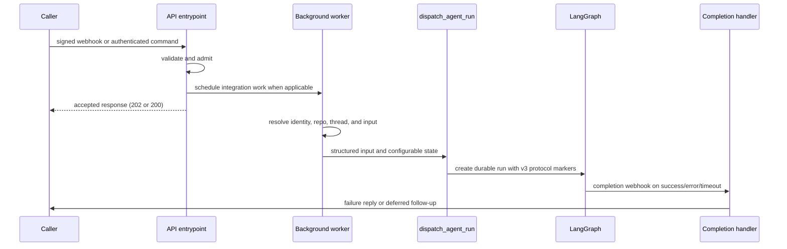

# Invocation: From Trigger to Durable Run

Open SWE accepts work from signed integration callbacks (GitHub, Slack, Linear), an authenticated dashboard (including its desktop client), and scheduler ticks. These sources deliberately converge at the same LangGraph thread/run boundary, but retain source context and structured sender identities so the graph can act with the right repository, user credential, response surface, and history. See [Auth and security](../concepts/auth-and-security.md) for access policy, [Threads and state](../concepts/threads-and-state.md) for persistence, and [Follow-up messages](follow-up-messages.md) for mid-run behavior.

## Lifecycle overview

This shows the shared path: integration routes acknowledge after inexpensive admission checks, while dashboard commands proxy directly after enrichment. Webhook routes return `202 Accepted` immediately and process the event in the background; dashboard commands are synchronous proxies that return the response from LangGraph.

The application stack is composed via `create_app`, which assembles dashboard, plan, and workflow-approval routers with Linear, Slack, GitHub, Notion, and health/completion routers. It validates CORS middleware configuration to reject wildcard origins when credentials are enabled, and its lifespan startup validates sandbox provider and local-development LLM model configuration before serving. This makes route composition and startup validation part of the invocation boundary rather than responsibility of each webhook.

## Admission and webhook signatures

GitHub, Linear, Slack, and Notion read the raw request body and verify their respective platform signature (HMAC) before parsing JSON; invalid or missing signatures receive HTTP `401`. The verifiers fail closed when the signing secret is absent. Routes return JSON with `status` fields (`ignored`/`error`/`accepted`) rather than creating a run for malformed or ineligible events.

For accepted GitHub and Linear events, and the normal Slack message path, a FastAPI `BackgroundTasks` job does remote API access, metadata construction, and dispatch after the HTTP response returns `202`. Slack claims an event id before scheduling to make delivery deduplication the gate to a run, preventing duplicate processing from retried webhook deliveries.

## RunInput shape and structured input construction

Every run receives a `RunInput` TypedDict carrying `messages` (and optionally `files`). Messages are not arbitrary prompt strings; they are role-aware structured envelopes that carry identity, context, and content.

`RunInput` is built by `build_run_input`, which takes:
- **content**: the authored text or block list (could be a message, comment, issue description, etc.)
- **context** (`InputMessageContext`): sender identity, surface (slack/linear/github/web/automation), and kind (human/system)
- **channels**: list of channel/conversation identities (deduped so the model hears them once)
- **systems**: list of system identities (e.g., automation name, pull request thread marker)
- **injected_dynamic_context_hashes**: set of SHA-256 hashes of previously-shown context, used to detect re-introductions

The input serialization enforces `human` kind with `role: "user"` and `system` kind with `role: "user"`, XML-escapes authored content in `<input-message>` envelopes, and uses SHA-256-hashed dynamic context introductions. Untrusted channel topic and purpose fields are explicitly marked `trust="untrusted"`.

Identity/context introductions are rendered as XML `<dynamic-context>` blocks: identity is an optional introduction when it is first seen in a turn, and its hash is tracked so re-introduction can be skipped on later turns when the model still sees the same conversation. This keeps the prompt concise while maintaining full awareness across resumed/interrupted runs.

## RunConfig assembly and configurable state

Every run carries a `config` dict with a `configurable` sub-dict. This is the per-run contract that every graph node reads. It is assembled by webhooks, the dashboard, and cron launchers, merged and re-written at several hops, and contains:

- **Identity and provenance**: `thread_id`, `invocation_id` (with legacy `prepare_run_id` alias), `source` (slack/linear/github/web/automation/schedule), `workspace`, `environment`
- **Actor**: `github_login`, `github_user_id`, `user_email`, `started_by_id` (for system threads)
- **Repository**: `repo` (owner/name object), `branch_name`, `pr_number` (for reviewer runs)
- **Source context**: `slack_thread`, `linear_issue`, `notion_page`, `github_issue` (cross-platform refs)
- **Model and effort**: `agent_model_id`, `resolved_agent_model_id`, `resolved_agent_effort`
- **Protocol markers**: `__event_streaming_v2` (marks the v3 stream protocol), `invocation_started_at`

Unknown keys survive in configurable; writers add keys this module has never heard of, and call sites read, add to, and pass it on. Nothing validates configurable on write, so a single malformed value does not cost the run its `thread_id`; a field that fails validation is dropped.

## Invocation identity and deduplication

Every run is assigned an `invocation_id` via `new_invocation_id()`, which generates a UUID. This id is written to both `configurable["invocation_id"]` and `metadata["invocation_id"]`, with legacy aliases `prepare_run_id` and `metadata[prepare_run_id]` maintained for backward compatibility. The invocation_id is used to:

- **Deduplicate webhook deliveries**: a webhook route can claim an event id keyed by invocation_id before background work starts, so retries of the same delivery never create duplicate runs
- **Correlate retry state**: if a webhook is retried, the same invocation_id unifies the retry with the original attempt
- **Track run lifecycle through callbacks**: the completion webhook receives the invocation_id in metadata so it can correlate success/failure signals

## Thread identity and routing

Thread-id formulas are persisted routing contracts: webhooks, the dashboard, and the reviewer each re-derive the same id from the same external identifiers to find an existing thread. The formulas are:

- **Slack threads**: `slack_thread_id(channel, timestamp, nonce)` → deterministic URL namespace hash
- **Linear issues**: `linear_issue_thread_id(issue_id)` → SHA-256-based hash
- **GitHub issues**: `github_issue_thread_id(issue_id)` → SHA-256-based hash
- **GitHub PRs**: `pr_comment_thread_id(owner, repo, pr_number)` → deterministic URL namespace hash (agent coding work)
- **GitHub reviewer**: `reviewer_thread_id(owner, repo, pr_number)` → separate namespace for review state

PR comment runs recover an Open SWE-created branch's embedded UUID via `thread_id_from_branch`; otherwise they derive the PR-comment thread id from repository and PR number. Altering a formula or its stable input strings effectively orphans live threads, so these are immutable data contracts.

## Surface-specific trigger patterns

### Slack

The route resolves the Slack location before scheduling work. `resolve_slack_thread_id` prefers an explicit stored location mapping, then matching thread metadata, then the deterministic Slack-derived id. Conflicting metadata matches raise an error rather than guessing.

**Admission filters**: Slack rejects bots and self-messages, validates message-update identity and content change, and only handles an ordinary non-code-channel message if it is a mention, DM, ready-plan reply, or permitted untagged two-party reply. Code channels are different: every interaction shares the channel's session thread and is treated as directed at Open SWE.

Slack first obtains channel context. Operations are permitted only in DMs or channels confirmed not externally shared; an app mention in an external shared channel gets one deduplicated refusal reply and no run. Signed slash commands, code-channel actions, and supported Block Kit actions turn into explicit code-channel turns; plan/workflow approval actions instead update their approval state or enqueue the prescribed follow-up.

**Repository and user resolution**: A Slack worker fetches profile, thread history, channel context, mappings, and optional images, then records `SourceContext.slack_thread`, repository, user, title, environment, and plan mode in thread metadata and configurable state. A first message can select an environment with `env:<name>`; later turns retain the stored environment because the sandbox has already been chosen.

**Credential requirement**: Slack runs require a valid GitHub credential for the mapped triggering user unless the deployment is in bot-token-only mode, because coding work opens pull requests as that user. An unlinked or revoked credential produces an account-link/re-login prompt instead of dispatching.

**Input serialization**: The worker serializes channel, people/bots, historical messages, operational context, and the current request into typed input. Slack explicitly mentions and code-channel interactions use `multitask_strategy='interrupt'`, which halts an active run and resumes the agent with full history plus the new message. Ordinary follow-ups use `enqueue`, which preserves a queued-message order rather than interrupting. Message edits are queued rather than independently dispatched, so an edit corrects the existing conversation.

### Linear

Linear accepts only a non-bot `Comment` `create` event containing an Open SWE mention. Repository selection is deterministic in priority order: an explicit repository in the comment text, the author's dashboard default, team/project mapping, then team default; the result must satisfy the repository allowlist.

**Background work**: The background worker reacts 👀, uses the issue id as the thread key, fetches issue details, and selects the author email (falling back to creator then assignee) to map GitHub identity. It upserts thread metadata with the Linear issue source context and builds a system issue description plus per-author human comment messages. Image URLs can cause a vision-model fallback when the selected model cannot accept images. The worker dispatches and posts a trace comment linking the resulting Open SWE thread.

### GitHub

The GitHub route accepts a broader event family: issue/comment work directed at Open SWE, PR state events, auto-review triggers, pushes, and CI. It filters unsupported actions, enforces the repo allowlist where applicable, applies the public-repository organization gate, and requires an Open SWE mention for normal issue/comment work. PR open/ready events can start automatic review when that repository enables it; pushes evaluate watched PRs; replies to a review finding route to the reviewer path.

**PR comment runs**: A coding PR-comment run recovers an Open SWE-created branch's embedded UUID; otherwise it derives the PR-comment thread id from owner, repository, and PR number. It resolves the author's mapped email/token, retries once after a GitHub authentication failure, reacts 👀, fetches comments since the last tag, introduces each author, and dispatches the accumulated human input. Issue runs use their own deterministic issue id.

**Reviewer runs**: Reviewer work always uses the separate `reviewer_thread_id` namespace and `assistant_id="reviewer"`, keeping review state and the coding-agent graph isolated. Run metadata records the PR key for the run-completion webhook so the review page can refresh on completion.

## Dashboard, desktop, and automation sources

**Dashboard**: The dashboard proxies `run.start` commands to LangGraph after validating JSON, access, and thread state. A missing thread is allowed only for `run.start`, which lazily creates and stamps it as an interactive dashboard thread. It attributes the command to the authenticated GitHub user, resolves model/effort from team, profile, and request overrides, normalizes repository configuration, records participants and metadata, and replaces caller-provided raw messages with typed web input. Image input has strict type, count, size, and model-capability checks.

**Desktop client**: The desktop client uses this dashboard invocation path; downstream execution happens through a bridge (sandbox) that is bound to a thread. A thread can be moved to a machine running the desktop CLI via worktree handoff, after which desktop-specific validation ensures only allowlisted local projects or worktrees under the configured root are accessed during shell execution. Tool results are buffered at the bridge and later read during reconnection.

**Dashboard follow-ups and cancellation**: A dashboard follow-up to an active thread is persisted in the message queue, not immediately started as another dashboard run. Stop cancels every pending/running run on the thread rather than trusting cached latest-run metadata; if messages were queued, it starts a new empty-input durable run to drain them. Interactive posting is denied on admin or automation threads to non-admins, while surfaced-source threads are readable to authenticated organization members.

**Schedules and automation**: Schedules are workspace records backed by LangGraph crons targeting the `scheduler` assistant graph. The scheduler fans a schedule tick into task-specific work. `launch_scheduled_agent_run` creates a **fresh UUID thread** for each scheduled agent execution, obtains schedule/automation metadata, rechecks the creator's repository access, and establishes a Slack root message/thread for status replies when configured for Slack notifications. Failure to create the notification channel message prevents the run to preserve intended context. The system records `started_by_id` and marked as an automation source.

## The dispatch contract

`dispatch_agent_run` is the single agent/reviewer dispatch contract through which every trigger converges. It:

1. **Validates input shapes**: Refuses ambiguous calls that combine prebuilt `input` with raw `content`/identity arguments
2. **Selects the graph**: Uses `assistant_id` (default `"agent"` or `"reviewer"`)
3. **Constructs input if needed**: Calls `build_run_input` to serialize content and identity when not pre-built
4. **Delegates to durable creation**: Calls `create_durable_run` with the resolved input and configurable state

The `create_durable_run` function creates a run with Open SWE's durable defaults:

- **`multitask_strategy="interrupt"`** (default, overridable): Stops the active run and creates a new one. The stopped run's progress is preserved by sync checkpoints, and the new run resumes the agent with full history plus the new message. Used for explicit user requests (Slack mentions, code-channel commands).
- **`multitask_strategy="enqueue"`** (for follow-ups): Queues the new run for sequential processing after the active run completes. Preserves message ordering for untagged Slack replies and follow-up dashboard messages.
- **`durability="async"`**: Checkpoints each step while the next one runs, so a crash or process recycle resumes from at most a step back instead of losing all work.
- **`stream_resumable=True`**: The run's event stream is retained so a client that attaches later can replay it. Without this the dashboard cannot observe a run it did not start, because the v3 protocol only synthesizes the `lifecycle: running` event when it can replay events.
- **`stream_mode`** and **`stream_subgraphs`** with v3 compatibility marker: Marks the run with the v2 protocol key (`__event_streaming_v2=True` in configurable), includes stream modes (`values`, `updates`, `messages`, `custom`, `tasks`, `checkpoints`), and enables subgraph streaming. This preserves tools/lifecycle and nested-agent visibility for runs the dashboard did not start.

## Run metadata and PR tracking

`RunMetadata` is a Pydantic model recorded on every run for the run-completion webhook to read back. It currently captures:

- **`pull_request`**: The pull request whose review page shows this run (populated for reviewer and review-scout graphs when the config specifies `pr_number` and `repo`). The start and end of such runs invalidate the PR's dashboard widget.

The metadata is merged from caller-provided metadata and auto-computed metadata, with `invocation_id` and `invocation_started_at` preserved across merges. Additional metadata includes:

- **`slack_conversation_type`**: `"dm"` or `"channel"` for Slack runs, inferred from channel context
- **`user_id`**: The canonical user id resolved from configurable state (for tracing and auditing)
- **`title`**: Thread title (dashboard name or automation name)
- **`source`**: Where the trigger came from (slack/linear/github/web/automation/schedule)
- **`repo`**: Repository config (owner/name)

## Completion webhook and failure handling

When both `RUN_COMPLETE_WEBHOOK_SECRET` and an absolute non-loopback `COMPLETION_WEBHOOK_URL` are configured, dispatch attaches `/webhooks/run-complete?token=…` to the run; otherwise it deliberately omits the webhook so an invalid local URL cannot make all run creation fail. The receiving route is fail-closed on that token.

**Success handling**: On `success`, completion schedules a deduplicated Slack session-cost refresh.

**Failure and timeout handling**: On `error` or `timeout`, it loads thread metadata, settles an unfinished reviewer check where relevant, restores a code-channel session only if no later run is live, and best-effort posts a source-appropriate failure reply to Slack, Linear, GitHub, or Notion. Failure replies are idempotent per run id (with a legacy thread-level fallback when an old payload has no run id). `interrupted` is intentionally not treated as a user-visible failure because it is the normal replacement behavior for an interrupting follow-up.

## Resumed runs and interruption

When a new message interrupts an active run on the same thread:

1. The active run is halted with status `interrupted`
2. Its checkpoints preserve all progress and state
3. The new run resumes on the same thread with full message history + the new message
4. The agent resumes reasoning with context intact

For subagent (nested graph) context in resumed runs: the subagent context is forked fresh rather than reused, so each turn's subagent branches (e.g., coding branches in a PR agent) start clean but maintain full parent context visibility.

## Safe changes and focused verification

- Preserve raw-body verification before parsing and keep secrets fail-closed. Exercise Slack replay age, deduplication, external-channel refusal, and non-directed-message filters when changing admission.
- Treat `openswe/thread_ids.py` formulas and stored source context as compatibility surfaces. Test mapping conflicts rather than adding a heuristic that guesses a Slack thread.
- Keep all new invocation paths on `dispatch_agent_run` or `create_durable_run`; test their durability, protocol-v3 marker, resumability, metadata correlation, and completion-webhook fallback in `tests/agent/test_dispatch.py`.
- Test completion statuses, source-specific replies, per-run dedupe, cost refresh, reviewer-check cleanup, and intentional silence for interrupted/wakeup runs in `tests/webhooks/test_completion_webhook.py`.
- For dashboard changes, test lazy thread creation, attribution/config construction, content/image validation, and thread-wide cancellation/queue draining in `tests/dashboard/test_dashboard_thread_api.py`.
